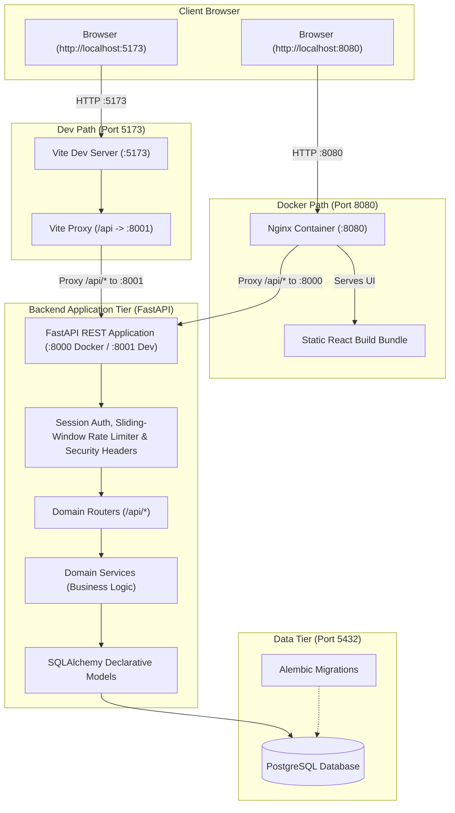

# University Learning &amp; Internship Platform

[](https://github.com/adexo-77/university-internship-platform/actions/workflows/ci.yml)

A production-grade, modular web platform designed for university student learning tracking, assignment evaluation, and internship discovery and application tracking. Built for the Brolf Tech internship technical challenge with a strict **MVP first, one phase at a time** methodology and comprehensive test coverage.

---

## 1. What the Platform Is &amp; Why It Was Built

Universities often face a disconnected ecosystem: academic coursework lives in a Learning Management System (LMS), while internship hunting occurs across external job boards and untracked emails. This leads to fragmented student records, lack of visibility for faculty mentors, and high friction for partner companies recruiting student talent.

The **University Learning &amp; Internship Platform** unifies these two critical workflows into a single system:
- **Academic Progress**: Instructors publish courses, issue structured assignments with deadlines, collect student submissions, and record grades with feedback comments.
- **Career Pathways**: Partner organizations register verified profiles, publish vetted internship opportunities, and manage candidate pipelines.
- **Institutional Governance**: University administrators oversee user accounts, approve corporate partners, and review internship postings before listings go live to protect students from unverified employers.

---

## 2. Features by Role

The platform provides tailored workspaces and dashboards for five primary user roles:

### 🎓 Student
- **Interactive Student Dashboard**: View enrolled courses, assignments due soon (flagged as urgent, upcoming, or past due), recent grade cards, and application pipeline metrics.
- **Achievement Badges**: Dynamically computed student milestone achievements across 8 rules (First submission, On-time habit, High achiever, Perfect score, Course finisher, Profile complete, First application, Offer accepted) with progress counters.
- **Course Enrollment**: Search the course catalog, enroll with duplicate guards, access assignment rosters, and monitor progress.
- **Course Learning Resources**: Access curated external documentation and study links associated with published courses in which the student is enrolled.
- **Assignment Submissions**: Submit text-based assignments before deadlines; late submissions are automatically flagged with timestamp metadata; submissions are locked against edits once graded.
- **Profile Management**: Maintain bio and technical skills tags; incomplete profiles trigger clear visual banners; showcase earned achievement badges.
- **Internship Discovery &amp; Applications**: Search published internships with work mode filters (remote, hybrid, onsite) and keyword searches; apply with personalized cover letters; withdraw pending applications with automatic confirmation guards.

### 👨‍🏫 Instructor
- **Instructor Dashboard**: Monitor active and draft courses, student enrollment totals, and a dedicated "Needs Grading" queue highlighting pending assignments.
- **Course Lifecycle**: Author courses with titles, descriptions, and syllabus outlines; manage status transitions (`draft`, `published`).
- **Course Learning Resources**: Author and curate external learning resources and documentation links (up to 50 per course) with validated HTTP/HTTPS URLs and full CRUD controls.
- **Gradebook CSV Export**: One-click export of complete enrolled student gradebook as a safe UTF-8 spreadsheet with per-assignment grades, submission totals, and class score averages.
- **Assignment Authoring**: Define assignments with due dates and maximum scores; edit or delete assignments with cascade protection.
- **Grading & Feedback**: Review student submissions in an organized roster, assign numeric scores (strictly bounded between 0 and max points), and provide actionable instructor feedback comments.

### 🏢 Organization (Employer)
- **Organization Dashboard**: Track live postings, pending administrator reviews, and applicant pipeline counts.
- **Corporate Profile**: Maintain company details, industry category, and official website URL.
- **Internship Posting Lifecycle**: Create postings with roles, requirements, locations, and deadlines; manage states (`draft` &rarr; `pending_review` &rarr; `open` &rarr; `closed`).
- **Applicant Pipeline Management**: Review student applications, inspect applicant profiles and cover letters, and execute hiring decisions (`shortlisted`, `accepted`, `rejected`) with state locking.
- **Applicants CSV Export**: Export applicant pipeline dataset with student academic profiles and timestamps.

### 📋 Internship Coordinator
- **Coordinator Dashboard**: Dedicated operational dashboard tracking pending employer registrations, internship postings awaiting moderation, live open postings, applicant pipeline distributions, and completed review counts.
- **Organization Vetting**: Review and decide on corporate partner registrations (`/api/admin/organizations*`) with full approval and rejection workflows.
- **Internship Moderation**: Review submitted postings (`/api/admin/internships*`), approve listings for public student discovery, reject with feedback notes, or take down compromised listings.
- **Listing & Applicant Visibility**: Search and inspect all internship listings across every lifecycle status and inspect applicant rosters in read-only mode to mentor students and monitor placement health.
- **Cross-Platform Reports**: Export comprehensive internship applications audit spreadsheet.
- **Institutional Boundaries**: Strictly separated from administrative user provisioning (`/api/admin/users*`), password resets, course administration, or system health operations.

### 🛡️ Administrator
- **Administrator Dashboard**: High-level platform health metrics, user account distributions, and pending review counts.
- **User Provisioning & Management**: Search, filter, inspect, activate, or deactivate user accounts across all roles; trigger administrative password resets.
- **Organization Vetting**: Review incoming employer registrations; approve or reject organizations before they are permitted to post listings.
- **Internship Moderation**: Review submitted postings; approve for public discovery or reject with explanatory review notes; take down compromised listings.
- **Cross-Platform Reports Area**: Export comprehensive platform application audits and master user accounts registry.

### 📊 Safe CSV Reports & Data Exports
- **Formula-Injection Defense**: Centralized sanitizer prefixes `'` to dangerous triggers (`=`, `+`, `-`, `@`, `\t`, `\r`) to protect Excel users from malicious execution.
- **UTF-8 with BOM**: Guarantees international script and Amharic text renders seamlessly in spreadsheet software.
- **Resource Protection**: Exports are row-capped at 10,000 rows with `Cache-Control: no-store` headers.
- **Sensitive Column Exclusion**: Never exposes password hashes, salts, reset tokens, or session IDs in exported data.

### 🔔 In-App Notifications (All Roles)
- **Top Navigation Indicator**: Real-time bell icon with petrol badge displaying unread notification count.
- **Visibility-Aware Polling**: Background check every 60 seconds while active, with immediate refetch on window focus.
- **Comprehensive Notification Center (`/notifications`)**: Dedicated feed with unread highlights, filter, individual mark-as-read, bulk read-all, and direct deep-linking to relevant resources.
- **Domain Event Triggers**: 10 lifecycle events across grading, submissions, reviews, applications, and security.
- **Automated Capacity Pruning**: PostgreSQL database trigger automatically caps history at 200 items per user.

---

## 3. Screenshots

Screenshots are located in `docs/screenshots/` when they exist.

---

## 4. Technology Stack

| Layer | Technologies | Rationale |
| :--- | :--- | :--- |
| **Backend** | Python 3.12+ / 3.14+, FastAPI, Pydantic v2, `pydantic-settings` | FastAPI REST API with synchronous threadpool execution, automatic OpenAPI schemas, and dependency injection. |
| **Database & ORM** | PostgreSQL 16+, SQLAlchemy 2 (ORM & 2.0 Core style), `psycopg` 3 (`psycopg[binary]`), Alembic | ACID-compliant relational persistence, declarative typing, and version-controlled database schema migrations. |
| **Frontend** | React 18, TypeScript (strict, zero `any`), Vite, React Router 7, Tailwind CSS, Lucide React | Modern SPA with type safety, clean component-driven architecture, and responsive styling. |
| **Testing** | Pytest, FastAPI `TestClient`, Vitest, React Testing Library | Full test pyramid: unit, service, integration, and UI component tests across both stacks. |
| **Code Quality** | Ruff (backend lint & format), ESLint 9 (flat config) + Prettier (frontend) | Enforced zero-warning policy, automated formatting, and strict code hygiene. |
| **CI / CD** | GitHub Actions (`.github/workflows/ci.yml`) | Automated pull request and push validation matrix covering backend tests, frontend tests, and migration checks. |

---

## 5. System Architecture



---

## 6. Quick Start

### Option A: Docker Compose (Fastest & Containerized)

Get up and running locally in three commands:

```powershell
Copy-Item .env.docker.example .env.docker
docker compose up --build -d --wait
docker compose run --rm backend python scripts/seed_demo.py
```

> **Troubleshooting 502 Bad Gateway**: If you encounter a `502 Bad Gateway` error in the first few seconds of startup, the backend container is still executing initial database migrations (`alembic upgrade head`). Using `docker compose up --build -d --wait` ensures the command returns only after all services pass their healthchecks. If the backend is restarting, Nginx automatically retries and resolves the upstream container dynamically.

Open [http://localhost:8080](http://localhost:8080) to access the application.

---

### Option B: Native Host Environment (PowerShell)

```powershell
# 1. Run Automated Setup & Seed
python scripts/setup_dev.py --seed

# 2. Start Backend Server (:8001)
Set-Location backend
.\.venv\Scripts\Activate.ps1
python -m uvicorn app.main:app --host 127.0.0.1 --port 8001 --reload

# 3. Start Frontend Client (:5173) in a separate terminal
Set-Location frontend
npm run dev
```

Visit [http://localhost:5173](http://localhost:5173) to explore the platform.

---

## 7. Demo Accounts &amp; Capabilities

All demo accounts are provisioned via `scripts/seed_demo.py`. For local evaluation, all demo roster accounts share the password `12345678`, marked demo-only and intentionally public.

| Name | Role | Email | Password (Demo-Only) | Profile State | What This Account Demonstrates |
| :--- | :--- | :--- | :--- | :--- | :--- |
| **Dr. Mulugeta Assefa** | Admin | `mulugeta.assefa@example.com` | `12345678` | Complete | Administrative dashboard, user provisioning &amp; password resets, organization registration approvals, internship moderation review queue, and listing takedowns. |
| **Ms. Selamawit Tadesse** | Coordinator | `selamawit.tadesse@example.com` | `12345678` | Complete | Coordinator dashboard, organization registration review &amp; approvals, internship moderation review queue, listing takedowns, and read-only applicant roster inspection. |
| **Dr. Tadesse Bekele** | Instructor | `tadesse.bekele@example.com` | `12345678` | Complete | Instructor dashboard, courses "Database Systems" (published) and "Introduction to Programming" (published), assignment authoring, and student submission grading. |
| **Ms. Hana Worku** | Instructor | `hana.worku@example.com` | `12345678` | Complete | Course authoring in draft state ("Software Engineering"), curriculum planning, and department course rosters. |
| **Abel Tesfaye** | Student | `abel.tesfaye@example.com` | `12345678` | Complete | Student dashboard, course progress, submitted ER Diagramming assignment (graded 100/100 with instructor feedback), accepted internship offer from Kaffa Digital Solutions, rejected application, and withdrawn application. |
| **Meron Girma** | Student | `meron.girma@example.com` | `12345678` | Complete | Student dashboard, course progress, late assignment submission awaiting instructor grading, shortlisted internship candidate at Kaffa Digital Solutions. |
| **Dawit Lemma** | Student | `dawit.lemma@example.com` | `12345678` | Incomplete | Incomplete profile demonstration showing the profile completion banner and the profile-complete rule before applying (blocking internship applications until university and department are saved); submitted application to Network Support Intern. |
| **Kaffa Digital Solutions** (Yohannes Haile) | Organization | `yohannes.haile@example.com` | `12345678` | Approved | Organization dashboard, postings across lifecycles (`open`, `pending_review`, `draft`, `rejected`), applicant hiring pipeline (accepted Abel Tesfaye, shortlisted Meron Girma). |
| **Gibe Valley Telecom Services** (Rahel Desta) | Organization | `rahel.desta@example.com` | `12345678` | Approved | Organization dashboard, network support &amp; systems administration postings, candidate rejection decision, and closed listing. |
| **Abay Data Labs** (Eyob Kassa) | Organization | `eyob.kassa@example.com` | `12345678` | Pending Approval | Pending approval banner demonstration, with internship creation disabled until platform administrator reviews and approves the company profile. |

> **Note**: All people and organizations in this demo dataset are fictional. The password `12345678` is marked demo-only and intentionally public for local demonstration and evaluation.

---

## 8. How to Run the Tests

### Backend Tests (Pytest)
```powershell
Set-Location backend
.\.venv\Scripts\Activate.ps1

# Run complete backend test suite
python -m pytest -v

# Or run quiet summary
python -m pytest -q
```

### Frontend Tests (Vitest)
```powershell
Set-Location frontend

# Run complete frontend test suite
npm test

# Run Vitest in watch mode
npm run test:watch
```

### Linting & Formatting Checks
```powershell
# Backend (Ruff)
Set-Location backend
.\.venv\Scripts\ruff.exe check .
.\.venv\Scripts\ruff.exe format --check .

# Frontend (ESLint 9 & Prettier)
Set-Location frontend
npm run lint
npm run format:check
```

---

## 9. Project Structure

```text
university-internship-platform/
├── .dockerignore              # Root Docker build context exclusion rules
├── .env.docker.example        # Template environment configuration for Docker Compose
├── .github/workflows/ci.yml   # Automated CI test, migration & docker smoke matrix
├── docker-compose.yml         # Container orchestration (db, backend, frontend)
├── docs/                      # Architectural designs, schemas, and specifications
│   ├── api.md                 # REST API reference and schema guide
│   ├── architecture.md        # Architecture topology and endpoint matrix
│   ├── database.md            # Mermaid ER diagram and schema specifications
│   ├── demo-script.md         # Evaluator walkthrough script & Q&A preparation
│   ├── design.md              # Design system tokens and UX rules
│   ├── openapi.json           # Exported OpenAPI 3.1 specification
│   ├── requirements.md        # Functional and non-functional requirements traceability
│   ├── security.md            # Threat model, controls matrix, and security policies
│   └── user-guide.md          # Step-by-step role-based user manual
├── scripts/                   # Administrative automation CLI tools
│   ├── create_user.py         # CLI administrative user provisioning tool
│   ├── export_openapi.py      # OpenAPI JSON schema exporter
│   ├── seed_demo.py           # Idempotent demo dataset seeder
│   └── setup_dev.py           # Cross-platform developer environment setup
├── backend/
│   ├── .dockerignore          # Backend Docker build exclusion rules
│   ├── Dockerfile             # Multi-stage backend container definition
│   ├── alembic/               # Database migration environment
│   ├── app/
│   │   ├── core/              # Config, database engine, security helpers, deps
│   │   ├── models/            # SQLAlchemy declarative models (one file per model)
│   │   ├── routers/           # Thin FastAPI HTTP endpoints (/api only)
│   │   ├── schemas/           # Pydantic validation schemas
│   │   └── services/          # Pure business logic and domain rules
│   └── tests/                 # Pytest test suite mirroring app/ domain modules
└── frontend/
    ├── .dockerignore          # Frontend Docker build exclusion rules
    ├── Dockerfile             # Multi-stage frontend container (build + Nginx)
    ├── nginx.conf             # Nginx reverse proxy, SPA fallback, gzip & security headers
    ├── src/
    │   ├── api/               # Typed API client wrappers
    │   ├── components/        # Modular, accessible UI components
    │   ├── context/           # React context providers (AuthContext)
    │   ├── hooks/             # Custom React hooks
    │   ├── pages/             # Page-level route views
    │   └── types/             # Shared TypeScript type definitions
    └── package.json           # Dependencies and test scripts
```

---

## 10. Security Summary

Security is integrated into every layer of the platform architecture:
- **Server-Side Session Authentication**: Session IDs are generated with cryptographically secure random bytes (`secrets.token_urlsafe(32)`), stored hashed in PostgreSQL, and transmitted exclusively via `HttpOnly`, `SameSite=Lax` cookies. Identity is **never** accepted from client headers or request bodies.
- **Scrypt Password Hashing**: User credentials are protected using Python's standard library `hashlib.scrypt` with a cryptographically secure 16-byte random salt and memory-hard computational parameters.
- **Role-Based Access Control (RBAC)**: Enforced strictly at the service and route dependency layer (`get_current_user`, `require_roles`). Frontend route guards and UI button states are purely ergonomic conveniences.
- **Ownership Verification & Cascading Guards**: Instructors can only modify their own courses; organizations can only edit their own postings; students can only submit work for courses in which they are actively enrolled.
- **Sliding-Window Rate Limiting**: In-memory sliding-window rate limiting guards sensitive endpoints (`/api/auth/login`, `/api/auth/register`, `/api/auth/change-password`) against brute-force attacks; clients receive `HTTP 429` with `Retry-After` headers and automatic frontend countdown notices.

For in-depth threat modeling, STRIDE analysis, and vulnerability mitigation matrices, refer to [docs/security.md](docs/security.md).

---

## 11. Known Limitations & Future Work

The platform was built under a strict MVP-first specification. The following items reflect current project boundaries and planned future enhancements:

1. **Implemented in Recent Phases**:
   - **In-App Notifications**: Full notification center (`/notifications`) with real-time unread badge, 60s visibility-aware polling, domain event hooks, and automated 200-item database capacity pruning trigger.
   - **Course Learning Resources**: Curated external learning resources and documentation links with full instructor CRUD controls and enrolled student visibility.
2. **Badges, Gamification & Rankings**: Course achievement badges, student leaderboards, and gamified ranking points are not implemented.
3. **Binary File Uploads & Media Streaming**: Direct binary file uploads (PDF slides, lecture videos, downloadable archives) and multimedia streaming are not implemented; curated external learning resource links are supported.
4. **AI-Driven Recommendations**: Automated resume parsing, candidate scoring, and machine-learning-based internship recommendations are not implemented; structured keyword search and work mode filters are provided.
5. **Email Verification & Self-Service Password Reset**: External SMTP/SES email delivery is not configured; accounts activate immediately upon registration, and password recovery is performed administratively or via authenticated password changes.
