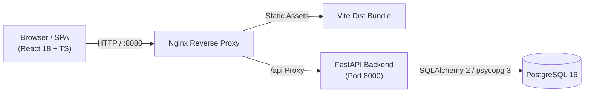

# University Learning &amp; Internship Platform

[](https://github.com/adexo-77/university-internship-platform/actions/workflows/ci.yml)

A web platform that integrates academic coursework management, assignment submission and grading, verified corporate internship postings, and university administrative oversight into a unified system. Built with Python FastAPI, PostgreSQL, and React with TypeScript, it enforces server-side role-based access control, relational data integrity, and strict input validation across all workflows.


## Features

- **Students**: Browse published courses, enroll with duplicate guards, access reference links, submit coursework with automatic late detection, discover vetted internships with rule-based match scores, apply with cover letters, and track progress with milestone achievement badges.
- **Instructors**: Author courses with structured syllabi, publish or archive courses, attach external reference links, set assignments with maximum point thresholds and deadlines, review student submissions, and submit bounded numeric grades with qualitative feedback.
- **Partner Organizations**: Maintain company profile, post internship listings with work mode and duration parameters, edit drafts, submit postings for institutional review, track applicant pipelines, and manage candidate hiring decisions (`submitted` &rarr; `shortlisted` &rarr; `accepted` / `rejected`).
- **Coordinators**: Review pending organization registrations, moderate submitted internship listings (approve or reject with feedback notes), inspect listings across all statuses, and monitor applicant rosters in read-only mode.
- **Administrators**: Platform-wide metrics dashboard, user account provisioning, account activation/deactivation guards, administrative password resets, organization approvals, internship moderation, and safe CSV data exports.

## Quick Start

### Docker (Recommended)

Run the application locally in three commands:

```powershell
Copy-Item .env.docker.example .env.docker
docker compose up --build -d --wait
docker compose run --rm backend python scripts/seed_demo.py
```

Open [http://localhost:8080](http://localhost:8080) to access the platform.

### Native Local Development

1. **Backend**: From `backend/`, copy `.env.example` to `.env`, create a Python 3.12+ virtual environment, install dependencies (`pip install -r requirements.txt -r requirements-dev.txt`), run migrations (`alembic upgrade head`), and start the API with `uvicorn app.main:app --port 8001 --reload`.
2. **Frontend**: From `frontend/`, install packages with `npm install` and run the development server with `npm run dev` (proxied to `:8001` at `http://localhost:5173`).

## Demo Accounts

All seeded demo accounts share the password `12345678` (demo-only, populated via `scripts/seed_demo.py`). For workflow walkthroughs, see [docs/user-guide.md](docs/user-guide.md).

| Name | Role | Email |
| :--- | :--- | :--- |
| Dr. Mulugeta Assefa | Admin | `mulugeta.assefa@example.com` |
| Ms. Selamawit Tadesse | Coordinator | `selamawit.tadesse@example.com` |
| Dr. Tadesse Bekele | Instructor | `tadesse.bekele@example.com` |
| Ms. Hana Worku | Instructor | `hana.worku@example.com` |
| Abel Tesfaye | Student | `abel.tesfaye@example.com` |
| Meron Girma | Student | `meron.girma@example.com` |
| Dawit Lemma | Student | `dawit.lemma@example.com` |
| Yohannes Haile | Organization (Approved) | `yohannes.haile@example.com` |
| Rahel Desta | Organization (Approved) | `rahel.desta@example.com` |
| Eyob Kassa | Organization (Pending) | `eyob.kassa@example.com` |

## Tech Stack

| Layer | Technologies | Key Libraries / Tools |
| :--- | :--- | :--- |
| **Backend** | Python 3.12+, FastAPI, Uvicorn | SQLAlchemy 2, Alembic, psycopg 3, Pydantic v2 |
| **Frontend** | React 18, TypeScript (strict), Vite | Tailwind CSS, Lucide React, React Router 6 |
| **Database** | PostgreSQL 16 | Relational constraints, triggers, indexes |
| **Testing** | Pytest, Vitest, React Testing Library | FastAPI TestClient, Ruff, ESLint, Prettier |
| **Packaging** | Docker, Docker Compose, Nginx | Multi-stage container builds, Alpine runtime |

## Architecture



## Testing & Quality Assurance

Run backend and frontend verification suites locally:

```powershell
# Backend lint, format check, and tests
.\backend\.venv\Scripts\ruff.exe check backend/
.\backend\.venv\Scripts\ruff.exe format --check backend/
.\backend\.venv\Scripts\pytest.exe -v

# Frontend lint, format check, tests, and production build
npm run --prefix frontend lint
npm run --prefix frontend format:check
npm test --prefix frontend -- --run
npm run --prefix frontend build
```

## Security Overview

- **Authentication & Sessions**: Stateful server sessions using cryptographically random 32-byte tokens hashed with SHA-256 in PostgreSQL, transmitted via `HttpOnly`, `SameSite=Lax` cookies.
- **Password Security**: Standard library `hashlib.scrypt` with unique 16-byte random salts per user (N=16384, r=8, p=1). Hashes are excluded from all API response models.
- **Authorization**: Server-side Role-Based Access Control (RBAC) enforced via FastAPI dependencies and service logic. UI guards are convenience layers only.
- **Input & Output Defenses**: Pydantic runtime schema validation, SQLAlchemy parameterized queries against SQL injection, HTML input sanitization against XSS, and formula-injection neutralization on CSV exports.
- **Traffic Controls**: Sliding-window rate limiters on authentication routes, origin verification on state-changing requests, and a 256 KB request size cap.

## Documentation Index

- [docs/architecture.md](docs/architecture.md): Topology, component boundaries, and endpoint security matrix.
- [docs/database.md](docs/database.md): Mermaid ER diagram, table schemas, foreign key relationships, and indexes.
- [docs/security.md](docs/security.md): Threat model, authentication architecture, and security controls.
- [docs/requirements.md](docs/requirements.md): Requirements coverage traceability matrix.
- [docs/api.md](docs/api.md): Complete REST API endpoint reference and query parameters.
- [docs/user-guide.md](docs/user-guide.md): Persona workflows, demo instructions, and visual interface walkthroughs.
- [docs/demo-script.md](docs/demo-script.md): Demo walkthrough script and technical Q&A reference.
- [docs/design.md](docs/design.md): Design system tokens, color palettes, and UX component rules.
- [CHANGELOG.md](CHANGELOG.md): Versioned release history grouped by capability.

## Roadmap & Known Limitations

- **Rankings**: Competitive leaderboards and peer rankings are deliberately omitted in favor of criterion-based milestone achievement badges.
- **File Uploads**: Course resources and submission artifacts are managed via validated external URLs rather than direct binary file storage.
- **Email Verification**: User registration activates accounts immediately without third-party SMTP email verification flows.
- **AI Features**: Internship suggestions use deterministic heuristic scoring based on profile skills, work mode, and location rather than machine learning models.
- **Cloud Deployment**: Containerized deployment is optimized for Docker Compose locally, with production deployment topologies documented in the architecture guide.

## Development

The project codebase was developed using automated tooling and verified against comprehensive test suites in Python and TypeScript. All architectural constraints, file-size limits, and conventions are specified in [AGENTS.md](AGENTS.md).
