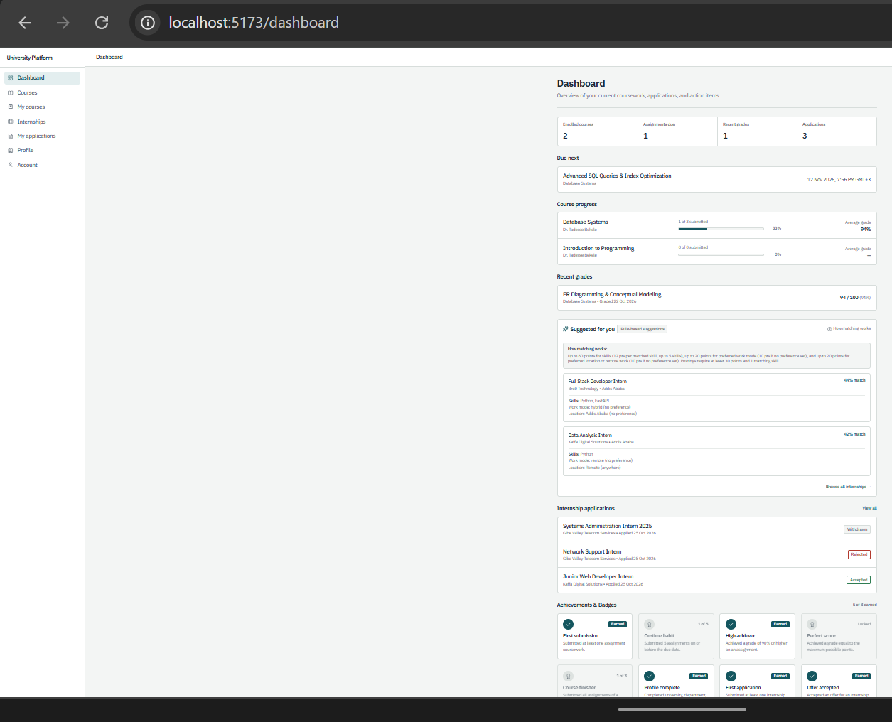
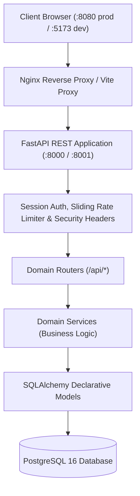

# University Learning &amp; Internship Platform

[](https://github.com/adexo-77/university-internship-platform/actions/workflows/ci.yml)

A modular web platform for university coursework tracking, assignment grading, and vetted internship discovery and application management.



## Quick Start

Run the application locally in three commands:

```powershell
Copy-Item .env.docker.example .env.docker
docker compose up --build -d --wait
docker compose run --rm backend python scripts/seed_demo.py
```

Open [http://localhost:8080](http://localhost:8080) to access the platform.

For native local development without Docker, see [docs/user-guide.md](docs/user-guide.md).

## Demo Accounts

All demo accounts use password `12345678` (demo-only, seeded via `scripts/seed_demo.py`). For complete capability details for each persona, see [docs/user-guide.md](docs/user-guide.md).

| Name | Role | Email |
| :--- | :--- | :--- |
| Dr. Mulugeta Assefa | Admin | `mulugeta.assefa@example.com` |
| Ms. Selamawit Tadesse | Coordinator | `selamawit.tadesse@example.com` |
| Dr. Tadesse Bekele | Instructor | `tadesse.bekele@example.com` |
| Ms. Hana Worku | Instructor | `hana.worku@example.com` |
| Abel Tesfaye | Student | `abel.tesfaye@example.com` |
| Meron Girma | Student | `meron.girma@example.com` |
| Dawit Lemma | Student | `dawit.lemma@example.com` |
| Kaffa Digital Solutions (Yohannes Haile) | Organization | `yohannes.haile@example.com` |
| Gibe Valley Telecom Services (Rahel Desta) | Organization | `rahel.desta@example.com` |
| Abay Data Labs (Eyob Kassa) | Organization | `eyob.kassa@example.com` |

## Features by Role

- **Student**: Course enrollment, assignment submission with late flags and locked grades, profile skills and work mode preferences, career recommendations, internship applications with cover letters, 8 dynamic achievement badges, and in-app notifications.
- **Instructor**: Course and syllabus authoring (`draft`/`published`), external learning resources management (up to 50 links per course), assignment lifecycle, numeric rubric grading with feedback comments, and course gradebook CSV export.
- **Organization**: Company profile management, internship posting lifecycle (`draft` -> `pending_review` -> `open` -> `closed`), applicant roster review, hiring decisions (`shortlisted`, `accepted`, `rejected`), and applicants CSV export.
- **Internship Coordinator**: Dedicated coordinator dashboard, organization vetting and approval, internship posting moderation queue (approval or rejection with notes), platform-wide listing and applicant inspection in read-only mode, and applications audit CSV export.
- **Administrator**: Comprehensive dashboard metrics, user account provisioning, activation/deactivation guards, administrative password resets, organization approvals, internship moderation, and master users registry CSV export.

## Coverage of Project Specifications

| Specification Item | Status | Where to See It / Notes |
| :--- | :---: | :--- |
| Users | Implemented | 5 roles with RBAC; see `backend/app/models/user.py`, `/api/auth/*`, and `/admin/users`. |
| Profiles and progress | Implemented | Academic profiles, technical skills, and preferences; see `/profile` and `StudentDashboard.tsx`. |
| Courses and learning resources | Implemented | Course lifecycle, syllabi, and external resource links (up to 50); see `/courses`. |
| Assignments and submissions | Implemented | Due dates, late flags, rubric grading, locked submissions; see `/assignments/:id`. |
| Internship opportunities and applications | Implemented | Postings lifecycle, moderation queue, applications, and decisions; see `/internships`. |
| Instructor dashboards | Implemented | Active courses, student counts, Needs Grading queue, and gradebook export; see `/dashboard`. |
| Progress tracking and notifications | Implemented | In-app notification center (`/notifications`), top-nav unread bell, 10 events, 200-item auto-pruning. |
| Reports and badges | Implemented | 8 dynamic achievement badges; 4 formula-injection-safe CSV exports; see `/admin/reports`. |
| Rankings | Not implemented | Competitive student leaderboards are not built; achievement badges are individual milestones. |
| AI opportunities | Partial | Rule-based matching (`/api/internships/suggestions`) on skills/preferences; LLM/vector models are not built. |
| Web | Implemented | Responsive single-page application built with React 18, TypeScript, and Tailwind CSS. |
| Mobile | Partial | Responsive web application tested on narrow viewports (360px); native mobile apps are not built. |
| REST API | Implemented | FastAPI REST API with OpenAPI 3.1 documentation at `/docs` and exported at `docs/openapi.json`. |
| PostgreSQL | Implemented | Relational schema, foreign keys, cascade rules, indexes, and Alembic migrations; see `backend/alembic/`. |
| Cloud | Not implemented | Managed cloud infrastructure is not built; local container orchestration uses Docker Compose. |

## Technology Stack

| Layer | Technologies | Notes |
| :--- | :--- | :--- |
| Backend | Python 3.12+, FastAPI, Pydantic v2, `pydantic-settings` | REST API, synchronous threadpool execution, OpenAPI schema generation, dependency injection. |
| Database & ORM | PostgreSQL 16+, SQLAlchemy 2 (ORM & 2.0 Core), `psycopg` 3, Alembic | ACID transactions, declarative models, version-controlled migrations. |
| Frontend | React 18, TypeScript (strict), Vite, React Router 7, Tailwind CSS, Lucide | Single-page application, custom design system tokens, responsive mobile drawer. |
| Testing | Pytest, FastAPI TestClient, Vitest, React Testing Library | Full test pyramid: backend unit and integration tests, frontend component tests. |
| Code Quality | Ruff, ESLint 9, Prettier | Enforced zero-warning policy, formatting checks, type guards. |
| CI | GitHub Actions | Automated lint, format, migration drift check, backend/frontend tests, and docker smoke test. |

## System Architecture



## Development Approach

This project was built with AI coding assistance and reviewed, tested, and validated by the author. Architectural standards, strict file line constraints, security policies, and technical conventions were enforced continuously through the project guidelines in [AGENTS.md](AGENTS.md), automated tests, and continuous integration workflows.

## Running the Tests

```powershell
# Backend tests (from backend/ with virtual environment activated)
python -m pytest -v

# Frontend tests (from frontend/)
npm test -- --run

# Linting and formatting checks
ruff check backend/
ruff format --check backend/
npm --prefix frontend run lint
npm --prefix frontend run format:check
```

## Security Summary

- **Server-Side Session Authentication**: 32-byte cryptographically secure random session tokens, stored hashed in PostgreSQL, transmitted exclusively via `HttpOnly`, `SameSite=Lax` cookies. Identity is never accepted from client headers or request bodies.
- **Scrypt Password Hashing**: Passwords hashed using standard library `hashlib.scrypt` with a 16-byte random salt and memory-hard parameters.
- **Role-Based Access Control**: Server-enforced authorization across all endpoints via route dependencies (`require_roles`).
- **Resource Ownership Guards**: Strict checks ensure instructors only modify their own courses and organizations only edit their own postings.
- **Sliding-Window Rate Limiting**: In-memory sliding-window limiter on `/api/auth/login`, `/api/auth/register`, and `/api/auth/change-password` returning HTTP 429 with `Retry-After`.
- **Safe CSV Exports**: Formula-injection sanitization (prepends `'` to `=`, `+`, `-`, `@`) and UTF-8 BOM encoding for Amharic text support.

## Known Limitations

- **Rankings and Gamification**: Competitive student leaderboards and peer ranking comparisons are not built; milestone badges are individual without competitive scoring.
- **AI and Machine Learning**: No LLM parsing or vector embeddings are used; matching uses a deterministic rule-based scoring algorithm (skills, work mode, and location).
- **Binary File Storage**: Direct file and media uploads are not implemented; external documentation URLs are supported.
- **Mobile Application**: Provided as a responsive web application tested on narrow (360px) viewports, not as a native mobile application.
- **Email Delivery**: External SMTP email delivery is not configured; accounts activate immediately upon registration.
- **Cloud Infrastructure**: Cloud orchestration and deployment (e.g. AWS/GCP/Kubernetes) are not built; local Docker Compose is provided.

## Documentation Index

- [docs/architecture.md](docs/architecture.md): System topology, middleware pipeline, and endpoint permission matrix.
- [docs/database.md](docs/database.md): Schema specifications, Mermaid ER diagram, and migration history.
- [docs/api.md](docs/api.md): REST API endpoint reference and query parameters.
- [docs/user-guide.md](docs/user-guide.md): Role-by-role user manual and pre-seeded demo walkthrough.
- [docs/demo-script.md](docs/demo-script.md): Demo walkthrough script and Q&A reference.
- [docs/security.md](docs/security.md): Threat model, security controls, and vulnerability mitigations.
- [docs/requirements.md](docs/requirements.md): Functional and non-functional requirements traceability.
- [docs/design.md](docs/design.md): Design tokens, color palette, typography, and UX guidelines.
- [CHANGELOG.md](CHANGELOG.md): Project release history.
- [AGENTS.md](AGENTS.md): Development guidelines, architecture rules, and conventions.
