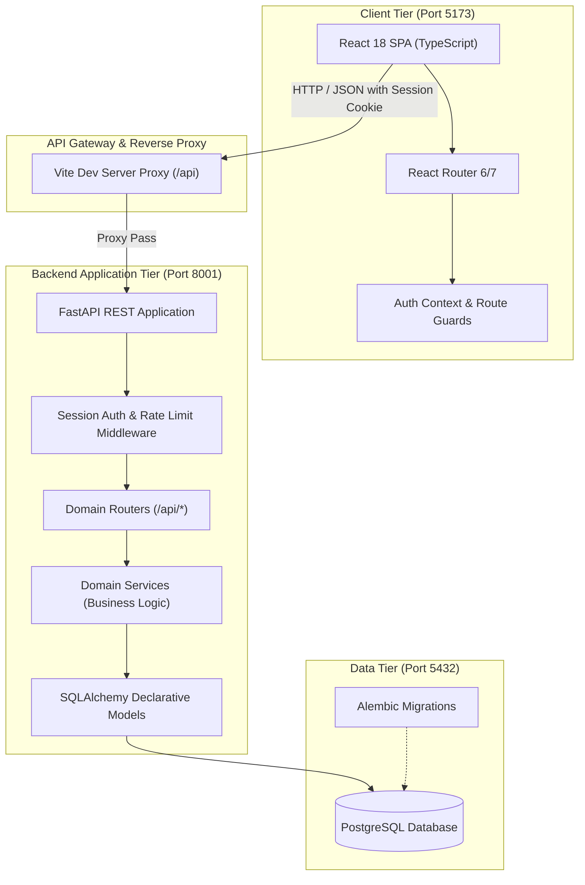

# University Learning &amp; Internship Platform

[](https://github.com/adexo-77/university-internship-platform/actions/workflows/ci.yml)

A production-grade, modular web platform designed for university student learning tracking, assignment evaluation, and internship discovery and application tracking. Built for the Brolf Tech internship technical challenge with a strict **MVP first, one phase at a time** methodology and comprehensive test coverage.

---

## 1. What the Platform Is &amp; Why It Was Built

Universities often face a disconnected ecosystem: academic coursework lives in a Learning Management System (LMS), while internship hunting occurs across external job boards and untracked emails. This leads to fragmented student records, lack of visibility for faculty mentors, and high friction for partner companies recruiting student talent.

The **University Learning &amp; Internship Platform** unifies these two critical workflows into a single system:
- **Academic Progress**: Instructors publish courses, issue structured assignments with deadlines, collect student submissions, and record grades with feedback comments.
- **Career Pathways**: Partner organizations register verified profiles, publish vetted internship opportunities, and manage candidate pipelines.
- **Institutional Governance**: University administrators oversee user accounts, approve corporate partners, and review internship postings before listings go live to protect students from unverified employers.

---

## 2. Features by Role

The platform provides tailored workspaces and dashboards for four primary user roles:

### 🎓 Student
- **Interactive Student Dashboard**: View enrolled courses, assignments due soon (flagged as urgent, upcoming, or past due), recent grade cards, and application pipeline metrics.
- **Course Enrollment**: Search the course catalog, enroll with duplicate guards, access assignment rosters, and monitor progress.
- **Course Learning Resources**: Access curated external documentation and study links associated with published courses in which the student is enrolled.
- **Assignment Submissions**: Submit text-based assignments before deadlines; late submissions are automatically flagged with timestamp metadata; submissions are locked against edits once graded.
- **Profile Management**: Maintain bio and technical skills tags; incomplete profiles trigger clear visual banners.
- **Internship Discovery &amp; Applications**: Search published internships with work mode filters (remote, hybrid, onsite) and keyword searches; apply with personalized cover letters; withdraw pending applications with automatic confirmation guards.

### 👨‍🏫 Instructor
- **Instructor Dashboard**: Monitor active and draft courses, student enrollment totals, and a dedicated "Needs Grading" queue highlighting pending assignments.
- **Course Lifecycle**: Author courses with titles, descriptions, and syllabus outlines; manage status transitions (`draft`, `published`, `archived`).
- **Course Learning Resources**: Author and curate external learning resources and documentation links (up to 50 per course) with validated HTTP/HTTPS URLs and full CRUD controls.
- **Assignment Authoring**: Define assignments with due dates and maximum scores; edit or delete assignments with cascade protection.
- **Grading &amp; Feedback**: Review student submissions in an organized roster, assign numeric scores (strictly bounded between 0 and max points), and provide actionable instructor feedback comments.

### 🏢 Organization (Employer)
- **Organization Dashboard**: Track live postings, pending administrator reviews, and applicant pipeline counts.
- **Corporate Profile**: Maintain company details, industry category, company size, and official website URL.
- **Internship Posting Lifecycle**: Create postings with roles, requirements, locations, stipends, and deadlines; manage states (`draft` &rarr; `pending_review` &rarr; `open` &rarr; `closed`).
- **Applicant Pipeline Management**: Review student applications, inspect applicant profiles and cover letters, and execute hiring decisions (`shortlisted`, `accepted`, `rejected`) with state locking.

### 🛡️ Administrator
- **Administrator Dashboard**: High-level platform health metrics, user account distributions, and pending review counts.
- **User Provisioning &amp; Management**: Search, filter, inspect, activate, or deactivate user accounts across all roles; trigger administrative password resets.
- **Organization Vetting**: Review incoming employer registrations; approve or reject organizations before they are permitted to post listings.
- **Internship Moderation**: Review submitted postings; approve for public discovery or reject with explanatory review notes; take down compromised listings.

---

## 3. Screenshots

> *Note: The `docs/screenshots/` directory is currently empty; screenshot embeds have been skipped.*

---

## 4. Technology Stack

| Layer | Technologies | Rationale |
| :--- | :--- | :--- |
| **Backend** | Python 3.12+ / 3.14+, FastAPI, Pydantic v2, `pydantic-settings` | High performance asynchronous REST API with automatic OpenAPI validation schemas and dependency injection. |
| **Database &amp; ORM** | PostgreSQL 16+, SQLAlchemy 2 (ORM &amp; 2.0 Core style), `psycopg` 3 (`psycopg[binary]`), Alembic | ACID-compliant relational persistence, declarative typing, and version-controlled database schema migrations. |
| **Frontend** | React 18, TypeScript (strict, zero `any`), Vite, React Router, Tailwind CSS, Lucide React | Modern SPA with type safety, clean component-driven architecture, and responsive styling. |
| **Testing** | Pytest, FastAPI `TestClient`, Vitest, React Testing Library | Full test pyramid: unit, service, integration, and UI component tests across both stacks. |
| **Code Quality** | Ruff (backend lint &amp; format), ESLint 9 (flat config) + Prettier (frontend) | Enforced zero-warning policy, automated formatting, and strict code hygiene. |
| **CI / CD** | GitHub Actions (`.github/workflows/ci.yml`) | Automated pull request and push validation matrix covering backend tests, frontend tests, and migration checks. |

---

## 5. System Architecture



---

## 6. Quick Start

### Option A: Docker Compose (Fastest & Containerized)

Get up and running locally in three commands:

```powershell
Copy-Item .env.docker.example .env.docker
docker compose up --build -d --wait
docker compose run --rm backend python scripts/seed_demo.py
```

> **Troubleshooting 502 Bad Gateway**: If you encounter a `502 Bad Gateway` error in the first few seconds of startup, the backend container is still executing initial database migrations (`alembic upgrade head`). Using `docker compose up --build -d --wait` ensures the command returns only after all services pass their healthchecks. If the backend is restarting, Nginx automatically retries and resolves the upstream container dynamically.

Open [http://localhost:8080](http://localhost:8080) to access the application.

---

### Option B: Native Host Environment (PowerShell)

```powershell
# 1. Run Automated Setup & Seed
python scripts/setup_dev.py --seed

# 2. Start Backend Server (:8001)
Set-Location backend
.\.venv\Scripts\Activate.ps1
python -m uvicorn app.main:app --host 127.0.0.1 --port 8001 --reload

# 3. Start Frontend Client (:5173) in a separate terminal
Set-Location frontend
npm run dev
```

Visit [http://localhost:5173](http://localhost:5173) to explore the platform.

---

## 7. Demo Accounts &amp; Capabilities

All demo accounts are provisioned via `scripts/seed_demo.py`. For local evaluation, all demo roster accounts share the password `12345678`, marked demo-only and intentionally public.

| Name | Role | Email | Password (Demo-Only) | Profile State | What This Account Demonstrates |
| :--- | :--- | :--- | :--- | :--- | :--- |
| **Dr. Mulugeta Assefa** | Admin | `mulugeta.assefa@example.com` | `12345678` | Complete | Administrative dashboard, user provisioning &amp; password resets, organization registration approvals, internship moderation review queue, and listing takedowns. |
| **Dr. Tadesse Bekele** | Instructor | `tadesse.bekele@example.com` | `12345678` | Complete | Instructor dashboard, courses "Database Systems" (published) and "Introduction to Programming" (published), assignment authoring, and student submission grading. |
| **Ms. Hana Worku** | Instructor | `hana.worku@example.com` | `12345678` | Complete | Course authoring in draft state ("Software Engineering"), curriculum planning, and department course rosters. |
| **Abel Tesfaye** | Student | `abel.tesfaye@example.com` | `12345678` | Complete | Student dashboard, course progress, submitted ER Diagramming assignment (graded 94/100 with instructor feedback), accepted internship offer from Kaffa Digital Solutions, rejected application, and withdrawn application. |
| **Meron Girma** | Student | `meron.girma@example.com` | `12345678` | Complete | Student dashboard, course progress, late assignment submission awaiting instructor grading, shortlisted internship candidate at Kaffa Digital Solutions. |
| **Dawit Lemma** | Student | `dawit.lemma@example.com` | `12345678` | Incomplete | Incomplete profile demonstration showing the profile completion banner and the profile-complete rule before applying (blocking internship applications until university and department are saved); submitted application to Network Support Intern. |
| **Kaffa Digital Solutions** (Yohannes Haile) | Organization | `yohannes.haile@example.com` | `12345678` | Approved | Organization dashboard, postings across lifecycles (`open`, `pending_review`, `draft`, `rejected`), applicant hiring pipeline (accepted Abel Tesfaye, shortlisted Meron Girma). |
| **Gibe Valley Telecom Services** (Rahel Desta) | Organization | `rahel.desta@example.com` | `12345678` | Approved | Organization dashboard, network support &amp; systems administration postings, candidate rejection decision, and closed listing. |
| **Abay Data Labs** (Eyob Kassa) | Organization | `eyob.kassa@example.com` | `12345678` | Pending Approval | Pending approval banner demonstration, with internship creation disabled until platform administrator reviews and approves the company profile. |

> **Note**: All people and organizations in this demo dataset are fictional. The password `12345678` is marked demo-only and intentionally public for local demonstration and evaluation.

---

## 8. How to Run the Tests

### Backend Tests (Pytest)
```powershell
Set-Location backend
.\.venv\Scripts\Activate.ps1

# Run complete backend test suite (219 tests across 46 test suites)
python -m pytest -v

# Or run quiet summary
python -m pytest -q
```

### Frontend Tests (Vitest)
```powershell
Set-Location frontend

# Run complete frontend test suite (213 tests across 61 test suites)
npm test

# Run Vitest in watch mode
npm run test:watch
```

### Linting &amp; Formatting Checks
```powershell
# Backend (Ruff)
Set-Location backend
.\.venv\Scripts\ruff.exe check .
.\.venv\Scripts\ruff.exe format --check .

# Frontend (ESLint 9 & Prettier)
Set-Location frontend
npm run lint
npm run format:check
```

---

## 9. Project Structure

```text
university-internship-platform/
├── .dockerignore              # Root Docker build context exclusion rules
├── .env.docker.example        # Template environment configuration for Docker Compose
├── .github/workflows/ci.yml   # Automated CI test, migration & docker smoke matrix
├── docker-compose.yml         # Container orchestration (db, backend, frontend)
├── docs/                      # Architectural designs, schemas, and specifications
│   ├── api.md                 # REST API reference and schema guide
│   ├── architecture.md        # Architecture topology and endpoint matrix
│   ├── database.md            # Mermaid ER diagram and schema specifications
│   ├── demo-script.md         # Evaluator walkthrough script & Q&A preparation
│   ├── design.md              # Design system tokens and UX rules
│   ├── openapi.json           # Exported OpenAPI 3.1 specification
│   ├── requirements.md        # Functional and non-functional requirements traceability
│   ├── security.md            # Threat model, controls matrix, and security policies
│   └── user-guide.md          # Step-by-step role-based user manual
├── scripts/                   # Administrative automation CLI tools
│   ├── create_user.py         # CLI administrative user provisioning tool
│   ├── export_openapi.py      # OpenAPI JSON schema exporter
│   ├── seed_demo.py           # Idempotent demo dataset seeder
│   └── setup_dev.py           # Cross-platform developer environment setup
├── backend/
│   ├── .dockerignore          # Backend Docker build exclusion rules
│   ├── Dockerfile             # Multi-stage backend container definition
│   ├── alembic/               # Database migration environment
│   ├── app/
│   │   ├── core/              # Config, database engine, security helpers, deps
│   │   ├── models/            # SQLAlchemy declarative models (one file per model)
│   │   ├── routers/           # Thin FastAPI HTTP endpoints (/api only)
│   │   ├── schemas/           # Pydantic validation schemas
│   │   └── services/          # Pure business logic and domain rules
│   └── tests/                 # Pytest test suite mirroring app/ domain modules
└── frontend/
    ├── .dockerignore          # Frontend Docker build exclusion rules
    ├── Dockerfile             # Multi-stage frontend container (build + Nginx)
    ├── nginx.conf             # Nginx reverse proxy, SPA fallback, gzip & security headers
    ├── src/
    │   ├── api/               # Typed API client wrappers
    │   ├── components/        # Modular, accessible UI components
    │   ├── context/           # React context providers (AuthContext)
    │   ├── hooks/             # Custom React hooks
    │   ├── pages/             # Page-level route views
    │   └── types/             # Shared TypeScript type definitions
    └── package.json           # Dependencies and test scripts
```

---

## 10. Security Summary

Security is integrated into every layer of the platform architecture:
- **Server-Side Session Authentication**: Session IDs are generated with cryptographically secure random bytes (`secrets.token_urlsafe(32)`), stored hashed in PostgreSQL, and transmitted exclusively via `HttpOnly`, `SameSite=Lax` cookies. Identity is **never** accepted from client headers or request bodies.
- **Argon2id Password Hashing**: User credentials are protected using `pwdlib`'s Argon2id algorithm with per-user salt and high memory/time hardness factors.
- **Role-Based Access Control (RBAC)**: Enforced strictly at the service and route dependency layer (`get_current_user`, `require_role`). Frontend route guards and UI button states are purely ergonomic conveniences.
- **Ownership Verification &amp; Cascading Guards**: Instructors can only modify their own courses; organizations can only edit their own postings; students can only submit work for courses in which they are actively enrolled.
- **Rate Limiting &amp; Defense-in-Depth**: In-memory token-bucket rate limiting guards sensitive endpoints against brute force attacks; client handles `429 Too Many Requests` with automatic cooldown banners.

For in-depth threat modeling, STRIDE analysis, and vulnerability mitigation matrices, refer to [docs/security.md](docs/security.md).

---

## 11. Known Limitations &amp; Future Work

The platform was built under a strict MVP-first specification. The following features were deliberately left out of scope and represent clear opportunities for future phases:

1. **In-App Notification Center &amp; Webhooks**: Asynchronous events (such as submission grading or application status changes) are reflected immediately upon dashboard queries, but persistent notification inbox tables, email push alerts, and webhooks are not implemented.
2. **Badges, Gamification &amp; Rankings**: Course achievement badges, student leaderboards, and gamified ranking points are not implemented.
3. **Binary File Uploads &amp; Media Streaming**: Direct binary file uploads (PDF slides, lecture videos, downloadable archives) and multimedia streaming are not implemented; curated external learning resources and documentation links are supported.
4. **AI-Driven Recommendation Features**: Automated resume parsing, candidate scoring, and machine-learning-based internship recommendations are not implemented; only keyword search and a work-mode filter exist.
5. **Email Verification &amp; Self-Service Emailed Password Resets**: External SMTP/SES email delivery is not configured; user activation is immediate upon registration and password resets are managed administratively or via CLI tools.
