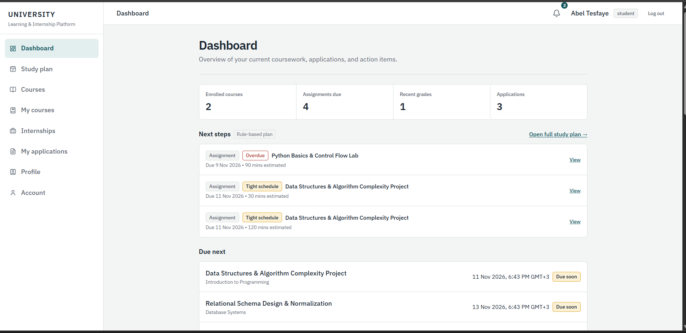
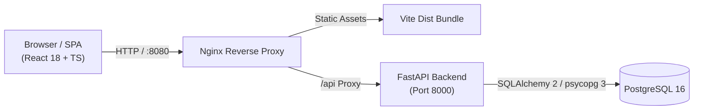

# University Learning &amp; Internship Platform

[](https://github.com/adexo-77/university-internship-platform/actions/workflows/ci.yml)

A web platform that integrates academic coursework management, assignment submission and grading, verified corporate internship postings, and university administrative oversight into a unified system. Built with Python FastAPI, PostgreSQL, and React with TypeScript, it enforces server-side role-based access control, relational data integrity, and strict input validation across all workflows.



## Features

- **Students**: Browse published courses, enroll with duplicate guards, access reference links, submit coursework with automatic late detection, discover vetted internships with rule-based match scores, apply with cover letters, and track progress with milestone achievement badges.
- **Instructors**: Author courses with structured syllabi, publish or archive courses, attach external reference links, set assignments with maximum point thresholds and deadlines, review student submissions, and submit bounded numeric grades with qualitative feedback.
- **Partner Organizations**: Maintain company profile, post internship listings with work mode and duration parameters, edit drafts, submit postings for institutional review, track applicant pipelines, and manage candidate hiring decisions (`submitted` &rarr; `shortlisted` &rarr; `accepted` / `rejected`).
- **Coordinators**: Review pending organization registrations, moderate submitted internship listings (approve or reject with feedback notes), inspect listings across all statuses, and monitor applicant rosters in read-only mode.
- **Administrators**: Platform-wide metrics dashboard, user account provisioning, account activation/deactivation guards, administrative password resets, organization approvals, internship moderation, and safe CSV data exports.

## Quick Start

### 1. Demo (Docker)

Run the full containerized platform (PostgreSQL, auto-migrated & pre-seeded FastAPI backend, and Nginx reverse proxy) with a single command:

```powershell
docker compose up --build -d --wait
```

Open [http://localhost:8080](http://localhost:8080). This stack runs on port `8080` and uses an isolated container PostgreSQL database volume (`postgres_data`).

To stop and remove containers and demo volumes:

```powershell
docker compose down -v
```

### 2. Development (Native)

For development with Hot Module Replacement (HMR) and FastAPI auto-reload:

```powershell
# One-time setup: configure virtual environment, install dependencies, and run migrations
python scripts/setup_dev.py

# Launch backend (:8001) and frontend (:5173) together with prefixed logs
python scripts/dev.py
```

Open [http://localhost:5173](http://localhost:5173). This stack runs on port `5173` (proxied to `:8001`) and connects to your local host PostgreSQL instance on port `5432` (`university_platform`).

## Demo Accounts

All seeded demo accounts share the password `12345678` (demo-only, populated via `scripts/seed_demo.py`). For workflow walkthroughs, see [docs/user-guide.md](docs/user-guide.md).

| Name | Role | Email |
| :--- | :--- | :--- |
| Dr. Mulugeta Assefa | Admin | `mulugeta.assefa@example.com` |
| Ms. Selamawit Tadesse | Coordinator | `selamawit.tadesse@example.com` |
| Dr. Tadesse Bekele | Instructor | `tadesse.bekele@example.com` |
| Ms. Hana Worku | Instructor | `hana.worku@example.com` |
| Abel Tesfaye | Student | `abel.tesfaye@example.com` |
| Meron Girma | Student | `meron.girma@example.com` |
| Dawit Lemma | Student | `dawit.lemma@example.com` |
| Yohannes Haile | Organization (Approved) | `yohannes.haile@example.com` |
| Rahel Desta | Organization (Approved) | `rahel.desta@example.com` |
| Eyob Kassa | Organization (Pending) | `eyob.kassa@example.com` |

## Tech Stack

| Layer | Technologies | Key Libraries / Tools |
| :--- | :--- | :--- |
| **Backend** | Python 3.12+, FastAPI, Uvicorn | SQLAlchemy 2, Alembic, psycopg 3, Pydantic v2 |
| **Frontend** | React 18, TypeScript (strict), Vite | Tailwind CSS, Lucide React, React Router 6 |
| **Database** | PostgreSQL 16 | Relational constraints, triggers, indexes |
| **Testing** | Pytest, Vitest, React Testing Library | FastAPI TestClient, Ruff, ESLint, Prettier |
| **Packaging** | Docker, Docker Compose, Nginx | Multi-stage container builds, Alpine runtime |

## Architecture



## Testing & Quality Assurance

Run backend and frontend verification suites locally:

```powershell
# Backend lint, format check, and tests
.\backend\.venv\Scripts\ruff.exe check backend/
.\backend\.venv\Scripts\ruff.exe format --check backend/
.\backend\.venv\Scripts\pytest.exe -v

# Frontend lint, format check, tests, and production build
npm run --prefix frontend lint
npm run --prefix frontend format:check
npm test --prefix frontend -- --run
npm run --prefix frontend build
```

### End-to-End (E2E) Browser Testing (Playwright)

The platform provides an automated Playwright browser test suite covering crawler discovery, WCAG AA accessibility audits, real CSV downloads, responsive viewports (360px to 1920px), error boundaries, and end-to-end user flows across all five roles.

> [!NOTE]
> The E2E suite is a developer verification tool run against the local Docker stack; it is not executed in headless CI environments.

**Test Architecture**:
- **Authentication Setup & `storageState` Reuse**: The `setup` project (`e2e/auth.setup.ts`) logs in once per role, storing session cookies in `e2e/.auth/<role>.json`. Subsequent test projects reuse these credentials directly, reducing HTTP login volume from hundreds of requests to just 5 initial sessions and staying well below the default security rate limits.
- **Fast Non-Destructive Suite (`npm run test:e2e:fast`)**: Runs crawler discovery, axe-core WCAG AA audits, layout overflow checks, and error paths across 5 viewport projects (`mobile-360`, `mobile-390`, `tablet-768`, `desktop-1440`, `desktop-1920`) without mutating application data.
- **Destructive Functional Flows (`npm run test:e2e:flows`)**: Executes multi-step transactional flows (enrollments, assignment grading, internship reviews, and CSV exports) sequentially in a dedicated `flows` project on desktop (`1440px`), with automated demo database resets (`scripts/seed_demo.py --reset-demo`) to guarantee isolation and repeatability.

**Prerequisites**:
1. Start the Docker stack with the testing override for relaxed rate limits:
   ```powershell
   docker compose -f docker-compose.yml -f docker-compose.e2e.yml up -d
   ```
2. Reseed the pristine demo dataset:
   ```powershell
   docker compose exec backend python -m scripts.seed_demo --reset-demo -y
   docker compose exec backend python -m scripts.seed_demo
   ```

**Commands & Runtime**:
```powershell
Set-Location frontend

# Full test suite (setup + 5 viewports + flows, finishes in under 10 minutes):
npm run test:e2e

# Fast non-destructive suite across all 5 viewports (~4-5 minutes):
npm run test:e2e:fast

# Functional flows on desktop with automated seed reset (~1-2 minutes):
npm run test:e2e:flows
```

## Security Overview

- **Authentication & Sessions**: Stateful server sessions using cryptographically random 32-byte tokens hashed with SHA-256 in PostgreSQL, transmitted via `HttpOnly`, `SameSite=Lax` cookies.
- **Password Security**: Password hashing uses Python standard library `hashlib.scrypt` (per-user salt, N=16384, r=8, p=1). Hashes are excluded from all API response models.
- **Authorization**: Server-side Role-Based Access Control (RBAC) enforced via FastAPI dependencies and service logic. UI guards are convenience layers only.
- **Input & Output Defenses**: Pydantic runtime schema validation, SQLAlchemy parameterized queries against SQL injection, HTML input sanitization against XSS, and formula-injection neutralization on CSV exports.
- **Traffic Controls**: Sliding-window rate limiters on authentication routes, origin verification on state-changing requests, and a 256 KB request size cap.

## Documentation Index

- [docs/architecture.md](docs/architecture.md): Topology, component boundaries, and endpoint security matrix.
- [docs/database.md](docs/database.md): Mermaid ER diagram, table schemas, foreign key relationships, and indexes.
- [docs/security.md](docs/security.md): Threat model, authentication architecture, and security controls.
- [docs/requirements.md](docs/requirements.md): Requirements coverage traceability matrix.
- [docs/api.md](docs/api.md): Complete REST API endpoint reference and query parameters.
- [docs/user-guide.md](docs/user-guide.md): Persona workflows, demo instructions, and visual interface walkthroughs.
- [docs/demo-script.md](docs/demo-script.md): Demo walkthrough script and technical Q&A reference.
- [docs/design.md](docs/design.md): Design system tokens, color palettes, and UX component rules.
- [docs/deployment.md](docs/deployment.md): Demo sharing via Cloudflare tunnel, operational limits, and production upgrade path.
- [CHANGELOG.md](CHANGELOG.md): Versioned release history grouped by capability.

## Roadmap & Known Limitations

- Rankings and leaderboards are not built.
- File uploads are not built (resources are links).
- Email verification and self-service password reset are not built.
- AI features are not built (matching is rule-based).
- Cloud deployment is not provisioned (Docker Compose only).

## Development

The project codebase was developed using automated tooling and verified against comprehensive test suites in Python and TypeScript. All architectural constraints, file-size limits, and conventions are specified in [AGENTS.md](AGENTS.md).
