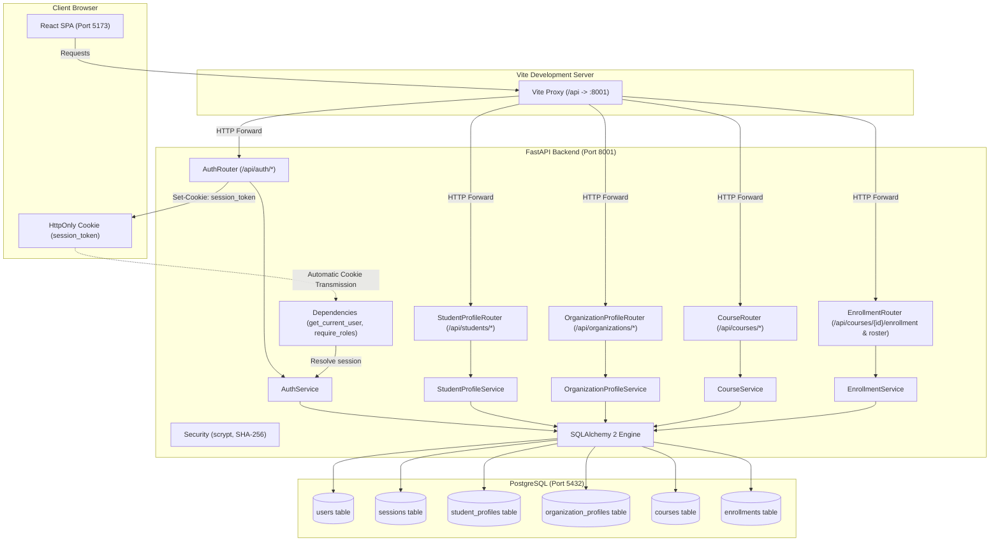
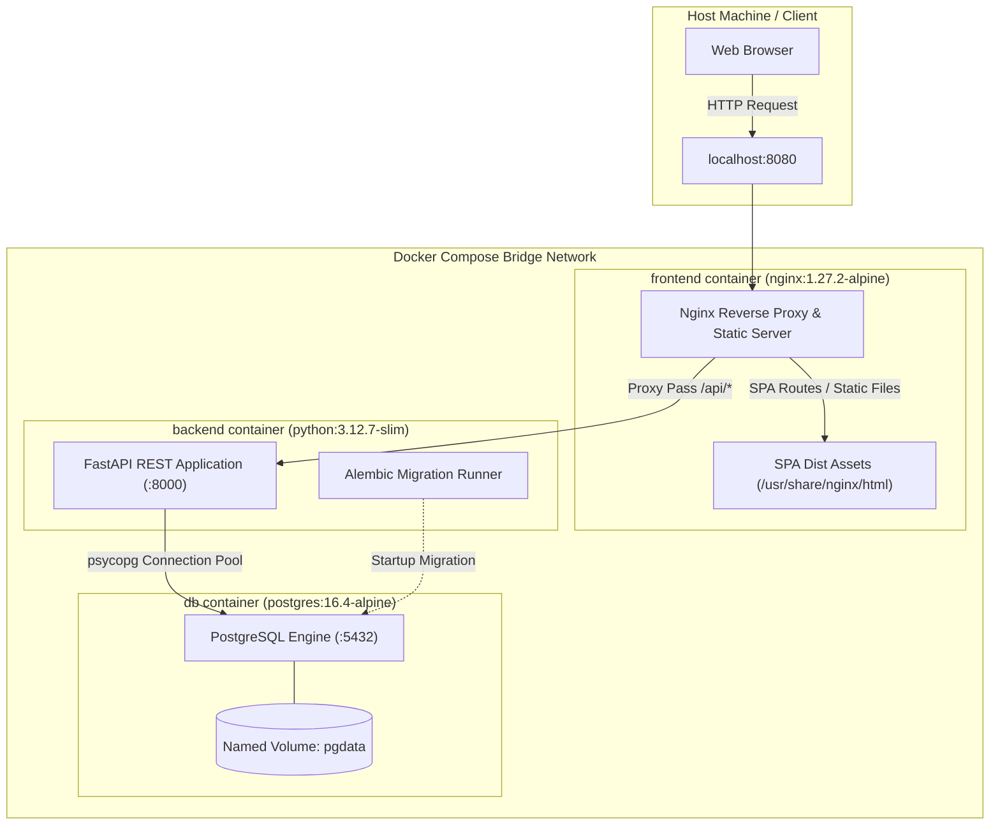

# Platform Architecture &bull; Authentication, Roles, Profiles, Courses &amp; Enrollment

## 1. Overview

The **University Learning & Internship Platform** is engineered with a modular, decoupled architecture prioritizing maintainability, strict typing, and high reliability.

- **Phase 1-2**: Authentication, sessions, RBAC (`student`, `instructor`, `organization`, `admin`), atomic user & profile provisioning.
- **Phase 3-4**: Courses, syllabi, enrollments, rosters, coursework submissions with late flags, and grading with score floors.
- **Phase 5**: Internship postings (draft/open/closed), search, applications with profile guards, and decision workflows.
- **Phase 5b-c**: Admin user management, organization approval, password changes, moderation review queue, and 90-day deadline extension caps.
- **Phase 6**: Role dashboards with aggregated metrics, progress percentages, and average grades.
- **Phase 7a**: Security hardening: sliding-window rate limiting, CSRF defense, security headers (`X-Frame-Options: DENY`, `no-store` cache), production cookie guards, 256 KB request limits, string/null-byte sanitization, structured logging, and generic 500 handlers.
- **Phase 8a**: Course learning resources: curated external documentation links (up to 50 per course) with owner management and enrolled student visibility.
- **Phase 8b**: In-app notifications: 10 domain lifecycle events, recipient isolation, no self-notifications, 200-notification capacity pruning trigger, bell icon with unread count indicator, 60s visibility-aware polling with focus refetch, mark as read, read-all, and full notifications page.
- **Phase 8c**: Internship coordinator role: dedicated institutional liaison persona for organization approval vetting, internship moderation queue decisions, read-only applicant roster inspection, and dedicated coordinator dashboard.

---

## 2. Component Boundaries

### 1. Backend Layer (`backend/app/`)
- **Core (`core/`)**:
  - `config.py`: Environment settings via `pydantic-settings` with production security guards.
  - `database.py`: SQLAlchemy 2 engine with connection pooling and `get_db()` dependency.
  - `security.py`: Password hashing with stdlib `hashlib.scrypt` and SHA-256 session token hashing.
  - `rate_limit.py`: Sliding-window in-memory limiter with injectable clock.
  - `csrf.py`: Mutation request Origin and Referer validation middleware.
  - `security_headers.py`: Security headers (`X-Frame-Options: DENY`, `no-store` cache).
  - `request_size.py`: 256 KB request payload size limiter.
  - `sanitization.py`: String sanitization and unicode email normalization.
  - `logging.py`: Structured request logging and generic 500 error handler with request IDs.
  - `deps.py`: `get_current_user` and `require_roles(*roles)` enforcing role authorization.
  - `exceptions.py`: Application exceptions mapped to standard HTTP status codes.
- **Models (`models/`)**:
  - `user.py`: `User` account model with `UserRole` enum (`student`, `instructor`, `organization`, `admin`, `coordinator`).
  - `session.py`: `Session` model with user FK and indexed `token_hash`.
  - `student_profile.py`: `StudentProfile` model with 1-to-1 cascade FK to users.
  - `organization_profile.py`: `OrganizationProfile` model with 1-to-1 cascade FK to users.
  - `course.py`: `Course` model with `CourseStatus` enum (`draft`, `published`), instructor FK, title, description, timestamps.
  - `enrollment.py`: `Enrollment` model linking course and student with unique constraint.
  - `assignment.py`: `Assignment` model with course FK, title, description, timezone-aware `due_at`, `max_points`, timestamps.
  - `course_resource.py`: `CourseResource` model with course FK, title, url, description, timestamps.
  - `submission.py`: `Submission` model linking assignment and student with unique constraint, content, link_url, is_late, grade, feedback, graded_at, graded_by.
  - `internship.py`: `InternshipPosting` model with organization FK, title, description, requirements, location, work mode, duration_weeks, application_deadline, status (`draft`, `open`, `closed`).
  - `application.py`: `Application` model linking posting and student with unique constraint, cover_letter, status (`submitted`, `shortlisted`, `accepted`, `rejected`, `withdrawn`), decision_message, decided_at.
  - `notification.py`: `Notification` model with user FK (cascade), `notification_kind` enum, title, message, validated relative `link_path`, `is_read`, and timestamps.
  - `base.py`: Central `DeclarativeBase` metadata class.
- **Schemas (`schemas/`)**:
  - `auth.py`: `RegisterRequest`, `LoginRequest`, `UserResponse`.
  - `student_profile.py`: `StudentProfileUpdateRequest`, `StudentProfileResponse`.
  - `organization_profile.py`: `OrganizationProfileUpdateRequest`, `OrganizationProfileResponse`.
  - `course.py`: `CourseCreate` (extra="forbid"), `CourseUpdate` (extra="forbid"), `CourseResponse`, `CourseListResponse`.
  - `course_resource.py`: `CourseResourceCreate` (extra="forbid", valid http/https), `CourseResourceUpdate` (extra="forbid"), `CourseResourceResponse`.
  - `enrollment.py`: `EnrolledStudentResponse`, `EnrollmentResponse`, `EnrollmentActionResponse`.
  - `assignment.py`: `AssignmentCreate` (extra="forbid", future due date), `AssignmentUpdate` (extra="forbid"), `AssignmentResponse`.
  - `submission.py`: `SubmissionSubmit` (extra="forbid", http/https validation), `SubmissionGrade` (extra="forbid"), `SubmissionResponse`, `StudentSubmissionRosterItem`.
  - `internship.py`: `InternshipCreate`, `InternshipUpdate`, `InternshipResponse`, `InternshipCatalogueItem`, `InternshipListResponse`, `MyInternshipItem`.
  - `application.py`: `ApplicationCreate`, `ApplicationDecision`, `ApplicationResponse`, `MyApplicationItem`, `ApplicantRosterItem`.
  - `notification.py`: `NotificationResponse`, `NotificationListResponse`, `UnreadCountResponse`.
  - `health.py`: Health verification schemas.
- **Routers (`routers/`)**:
  - Thin FastAPI HTTP endpoints under `/api`.
  - `auth.py`: `/register`, `/login`, `/logout`, `/me`.
  - `student_profile.py`: `/students/me`.
  - `organization_profile.py`: `/organizations/me`.
  - `course.py`: `/courses`, `/courses/{id}`, `/instructors/me/courses`, `/students/me/courses`.
  - `course_resource.py`: `/courses/{id}/resources`, `/resources/{id}`.
  - `enrollment.py`: `/courses/{id}/enrollment`, `/courses/{id}/students`.
  - `assignment.py`: `/courses/{id}/assignments`, `/assignments/{id}`.
  - `submission.py`: `/assignments/{id}/submission`, `/assignments/{id}/submissions`, `/submissions/{id}/grade`.
  - `internship.py`: `/internships`, `/organizations/me/internships`, `/internships/{id}`.
  - `application.py`: `/internships/{id}/applications`, `/students/me/applications`, `/applications/{id}/withdraw`, `/applications/{id}`, `/applications/{id}/decision`.
  - `notification.py`: `/notifications`, `/notifications/unread-count`, `/notifications/{id}/read`, `/notifications/read-all`.
  - `badge.py`: `/students/me/badges`.
  - `csv_export.py`: `/courses/{id}/gradebook.csv`, `/internships/{id}/applicants.csv`, `/admin/reports/applications.csv`, `/admin/reports/users.csv`.
- **Services (`services/`)**:
  - `AuthService`: Registration (atomic user + profile), authentication, session lifecycle.
  - `StudentProfileService`: Student profile retrieval and updates.
  - `OrganizationProfileService`: Organization profile retrieval and updates.
  - `course.py`: Course creation, detail lookup with draft visibility guard, update with draft-reversion lock.
  - `course_catalog.py`: Course search and pagination.
  - `course_resource.py`: Course learning resources listing with published/enrolled access check, creation (max 50 limit, URL scheme validation), updating, and cascade deletion.
  - `enrollment.py`: Course enrollment with duplicate prevention, unenrollment, and roster retrieval.
  - `assignment.py` & `assignment_query.py`: Assignment creation, course assignment listing with student submission status mapping, assignment detail lookup, update with max_points grade floor check, and deletion protected against existing submissions.
  - `submission.py`: Student assignment submission with server-clock late flag calculation and locked-after-graded protection, student submission lookup, instructor/admin submissions roster, and instructor grading with max_points bounds.
  - `internship.py`: Internship posting creation, detail lookup, update with status transitions (`draft`->`open`, `open`->`closed`), organization own postings list with applicant counts.
  - `internship_catalog.py`: Catalogue search and pagination for students and admin with applied status mapping.
  - `application.py`: Student application submission with profile completeness and open deadline guards, duplicate prevention, student application listing, withdrawal window, applicant roster retrieval, and organization decision transitions.
  - `notification.py`: Notification creation on 10 domain events, user notifications listing with pagination, unread counter, read status updates, link path validation, and 200-item capacity pruning.
  - `badge.py`: Dynamic student achievement badge computation on read across 8 milestone definitions with progress indicators.
  - `csv_export.py` & `csv_export_writer.py`: Safe CSV streaming generation with UTF-8 BOM, formula-injection sanitization, 10,000 row limits, and role/ownership security checks.
- **Frontend Layer (`frontend/src/`)**:
- **API (`api/`)**:
  - `auth.ts`, `profile.ts`, `course.ts`, `assignment.ts`, `internship.ts`, `application.ts`, `notification.ts`, `health.ts`, `badge.ts`.
- **Context &amp; Navigation (`context/`, `config/`)**:
  - `AuthContext`: Session lifecycle and user identity.
  - `navigation.ts`: Navigation items filtered per role, role-based `getHomePath` (organization routes to `/my-internships`).
- **Hooks (`hooks/`)**:
  - `useAuth.ts`, `useHealth.ts`, `useInternshipActions.ts`, `usePageTitle.ts`, `useUnreadCount.ts` (60s document visibility polling + window focus refetch).
- **Libraries (`lib/`)**:
  - `cn.ts`: Tailwind class utility.
  - `skills.ts`: Comma-separated skill string parsing.
  - `dates.ts`: Unambiguous date formatting (`formatDate`, `formatDateTime`, `formatRelativeTime`), due-soon (3 days), and past-due logic.
- **Components (`components/`)**:
  - `components/courses/`: `CourseForm`, `CourseTable`, `EnrollButton`, `StudentRosterTable`, `CourseResourcesSection`, `CourseResourceFormModal`.
  - `components/assignments/`: `AssignmentForm`, `AssignmentTable`, `CourseAssignmentsSection`, `DueBadge`, `GradeForm`, `SubmissionForm`, `SubmissionStatusBadge`, `SubmissionsTable`.
  - `components/internships/`: `InternshipForm`, `InternshipTable`, `InternshipStatusBadge`, `ApplyForm`, `ApplicationStatusBadge`, `ApplicantsTable`, `DecisionForm`, `MyApplicationsTable`, `StudentApplicationPanel`, `InternshipApplicantsSection`.
  - `components/notifications/`: `NotificationBell`, `NotificationItem`, `NotificationList`.
  - `components/ui/`: `Button`, `TextField`, `Textarea`, `Select`, `Badge`, `DataTable`, `EmptyState`, `ErrorMessage`, `Notice`, `PageHeader`.
  - `components/layout/`: `AppShell`.
  - `components/routes/`: `ProtectedRoute`, `RoleRoute`.
- **Pages (`pages/`)**:
  - `/courses`: Course catalogue with title search, pagination, and admin status badges.
  - `/my-courses`: Role-specific view (student enrolled courses; instructor courses with "New course" button).
  - `/courses/new`: Instructor course creation form.
  - `/courses/:id/edit`: Instructor/admin course editing form.
  - `/courses/:id`: Course detail view with student enroll/leave button, owner publishing, student roster table, and course assignments section.
  - `/courses/:courseId/assignments/new`: Instructor assignment creation form.
  - `/assignments/:id/edit`: Instructor assignment editing form.
  - `/assignments/:id`: Assignment detail view with student submission form / locked grade or instructor submissions roster.
  - `/assignments/:assignmentId/submissions/:submissionId/grade`: Instructor grading page.
  - `/internships`: Internship catalogue with search, work-mode filter, and pagination.
  - `/internships/:id`: Internship details view with student apply form or status / owner review and applicant roster.
  - `/my-internships`: Organization view with posting table, applicant count, publish/close actions, and new posting button.
  - `/internships/new`: Organization internship creation form.
  - `/internships/:id/edit`: Organization internship editing form.
  - `/my-applications`: Student applications table with status badges and withdraw action.
  - `/applications/:id`: Applicant review page with background profile, cover letter, and decision form.
  - `/notifications`: In-app notifications feed with unread highlights, filter, mark as read, and read-all actions.
  - `/profile`: Role-specific student and organization profile views.
  - `/account`: Account details and credentials overview.
  - `/status`: Admin system status view.

---

## 3. Endpoints Matrix

| Endpoint | Method | Role Access | Description | Success Code |
| :--- | :--- | :--- | :--- | :--- |
| `/api/auth/register` | `POST` | Public | Register student or organization (atomic profile creation) | `201 Created` |
| `/api/auth/login` | `POST` | Public | Authenticate credentials &amp; start session | `200 OK` |
| `/api/auth/logout` | `POST` | Public | Terminate session &amp; clear cookie | `200 OK` |
| `/api/auth/me` | `GET` | Authenticated | Retrieve current user profile | `200 OK` |
| `/api/students/me` | `GET` | `student` | Retrieve authenticated student profile | `200 OK` |
| `/api/students/me` | `PUT` | `student` | Update authenticated student profile | `200 OK` |
| `/api/organizations/me` | `GET` | `organization` | Retrieve authenticated organization profile | `200 OK` |
| `/api/organizations/me` | `PUT` | `organization` | Update authenticated organization profile | `200 OK` |
| `/api/courses` | `POST` | `instructor` | Create course owned by authenticated instructor | `201 Created` |
| `/api/courses` | `GET` | Authenticated | List published courses (or all for admin) with ?q= and pagination | `200 OK` |
| `/api/courses/{id}` | `GET` | Authenticated | Get course details (visible if published, owned, or admin) | `200 OK` |
| `/api/courses/{id}` | `PATCH` | `instructor` (owner), `admin` | Update course title, description, or publish | `200 OK` |
| `/api/instructors/me/courses` | `GET` | `instructor` | Get instructor's own courses with enrolled count | `200 OK` |
| `/api/students/me/courses` | `GET` | `student` | Get student's enrolled courses | `200 OK` |
| `/api/courses/{id}/students` | `GET` | `instructor` (owner), `admin` | Get enrolled student roster with names and emails | `200 OK` |
| `/api/courses/{id}/resources` | `GET` | `instructor` (owner), `admin`, `student` (enrolled) | List learning resources for course (enrolled only if published) | `200 OK` |
| `/api/courses/{id}/resources` | `POST` | `instructor` (owner) | Add learning resource link (up to 50 per course, http/https) | `201 Created` |
| `/api/resources/{id}` | `PATCH` | `instructor` (owner) | Update learning resource title, URL, or description | `200 OK` |
| `/api/resources/{id}` | `DELETE` | `instructor` (owner) | Delete course learning resource | `204 No Content` |
| `/api/courses/{id}/enrollment` | `POST` | `student` | Enroll student in published course | `201 Created` |
| `/api/courses/{id}/enrollment` | `DELETE` | `student` | Unenroll student from course | `200 OK` |
| `/api/courses/{id}/assignments` | `POST` | `instructor` (owner) | Create assignment with future due date | `201 Created` |
| `/api/courses/{id}/assignments` | `GET` | `instructor` (owner), `admin`, `student` (enrolled) | List course assignments (with student submission state) | `200 OK` |
| `/api/assignments/{id}` | `GET` | `instructor` (owner), `admin`, `student` (enrolled) | Get single assignment details | `200 OK` |
| `/api/assignments/{id}` | `PATCH` | `instructor` (owner) | Update assignment (max_points floor checked) | `200 OK` |
| `/api/assignments/{id}` | `DELETE` | `instructor` (owner) | Delete assignment (409 if submissions exist) | `204 No Content` |
| `/api/assignments/{id}/submission` | `PUT` | `student` (enrolled) | Submit or update coursework (late computed, 409 if graded) | `200 OK` |
| `/api/assignments/{id}/submission` | `GET` | `student` (enrolled) | Get student's own submission | `200 OK` |
| `/api/assignments/{id}/submissions` | `GET` | `instructor` (owner), `admin` | List every enrolled student with submission or null | `200 OK` |
| `/api/submissions/{id}/grade` | `PUT` | `instructor` (owner) | Grade submission (0 to max_points, feedback, regradable) | `200 OK` |
| `/api/internships` | `POST` | `organization` | Create internship posting with future deadline | `201 Created` |
| `/api/organizations/me/internships` | `GET` | `organization` | Get organization's own postings with applicant count | `200 OK` |
| `/api/internships/{id}` | `PATCH` | `organization` (owner) | Update posting fields in draft/rejected, or extend deadline up to 90 days if open | `200 OK` |
| `/api/internships/{id}/submit` | `POST` | `organization` (owner) | Submit draft or rejected posting for admin/coordinator review (requires approved org) | `200 OK` |
| `/api/internships/{id}/withdraw` | `POST` | `organization` (owner) | Withdraw pending_review posting back to draft for further editing | `200 OK` |
| `/api/internships/{id}/close` | `POST` | `organization` (owner) | Close open internship posting | `200 OK` |
| `/api/internships` | `GET` | `student`, `coordinator`, `admin` | Search catalogue (?q=, ?work_mode=, pagination); 403 for others | `200 OK` |
| `/api/internships/suggestions` | `GET` | `student` | Rule-based deterministic scored suggestions (?limit=) | `200 OK` |
| `/api/internships/{id}` | `GET` | `student` (if open), owner `organization`, `coordinator`, `admin` | Get internship details (404 for others) | `200 OK` |
| `/api/admin/internships` | `GET` | `coordinator`, `admin` | List postings for review queue (?status=, oldest first) | `200 OK` |
| `/api/admin/internships/{id}/review` | `PUT` | `coordinator`, `admin` | Approve, reject, or take down posting (note required for reject/takedown) | `200 OK` |
| `/api/internships/{id}/applications` | `POST` | `student` | Submit application (guards profile completeness, deadline, duplicates) | `201 Created` |
| `/api/students/me/applications` | `GET` | `student` | Get authenticated student's applications | `200 OK` |
| `/api/applications/{id}/withdraw` | `POST` | `student` (owner) | Withdraw application while submitted/shortlisted | `200 OK` |
| `/api/internships/{id}/applications` | `GET` | `organization` (owner), `coordinator`, `admin` | List applicant background profiles, cover letters, and statuses | `200 OK` |
| `/api/applications/{id}` | `GET` | `student` (owner), `organization` (owner), `coordinator`, `admin` | Get application details (404 for others) | `200 OK` |
| `/api/applications/{id}/decision` | `PUT` | `organization` (owner) | Decide application (`shortlisted`, `accepted`, `rejected`) | `200 OK` |
| `/api/auth/change-password` | `POST` | Authenticated | Change user's own password (invalidates other sessions) | `200 OK` |
| `/api/admin/users` | `GET` | `admin` | Search & paginate users (?q=, ?role=, ?is_active=) | `200 OK` |
| `/api/admin/users` | `POST` | `admin` | Provision instructor, admin, or coordinator account | `201 Created` |
| `/api/admin/users/{id}` | `PATCH` | `admin` | Toggle user is_active (guards self/last-admin, kills sessions) | `200 OK` |
| `/api/admin/users/{id}/password` | `PUT` | `admin` | Reset user password (invalidates user sessions) | `200 OK` |
| `/api/admin/organizations` | `GET` | `coordinator`, `admin` | List organizations with ?approval_status= filter & pagination | `200 OK` |
| `/api/admin/organizations/{user_id}/approval` | `PUT` | `coordinator`, `admin` | Approve, reject, or reset organization approval with note | `200 OK` |
| `/api/dashboard/student` | `GET` | `student` | Student coursework progress, due_next assignments, recent grades, and applications summary | `200 OK` |
| `/api/dashboard/instructor` | `GET` | `instructor` | Instructor courses overview, awaiting grading counts, and needs_grading queue | `200 OK` |
| `/api/dashboard/organization` | `GET` | `organization` | Organization approval status, posting status counts, and latest applications | `200 OK` |
| `/api/dashboard/coordinator` | `GET` | `coordinator` | Coordinator metrics: pending approvals & reviews, open postings, app statuses, reviews completed | `200 OK` |
| `/api/dashboard/admin` | `GET` | `admin` | Admin platform metrics, pending approvals and reviews, and status breakdowns | `200 OK` |
| `/api/notifications` | `GET` | Authenticated | Retrieve paginated notifications list for current user (?limit=, ?offset=) | `200 OK` |
| `/api/notifications/unread-count` | `GET` | Authenticated | Get total count of unread notifications for badge counter | `200 OK` |
| `/api/notifications/{id}/read` | `PATCH` | Authenticated | Mark a single notification owned by current user as read | `200 OK` |
| `/api/notifications/read-all` | `POST` | Authenticated | Mark all notifications owned by current user as read | `200 OK` |
| `/api/students/me/badges` | `GET` | `student` | Compute and retrieve student achievement badges on read | `200 OK` |
| `/api/courses/{id}/gradebook.csv` | `GET` | `instructor` (owner), `admin` | Export course student gradebook spreadsheet as safe UTF-8 CSV | `200 OK` |
| `/api/internships/{id}/applicants.csv` | `GET` | `organization` (owner), `coordinator`, `admin` | Export internship applicants dataset as safe UTF-8 CSV | `200 OK` |
| `/api/admin/reports/applications.csv` | `GET` | `coordinator`, `admin` | Export cross-platform internship applications audit spreadsheet | `200 OK` |
| `/api/admin/reports/users.csv` | `GET` | `admin` | Export registered user accounts registry spreadsheet (no secrets) | `200 OK` |
| `/api/health` | `GET` | Public | Basic platform status probe | `200 OK` |
| `/api/health/db` | `GET` | Public | Database query connectivity probe | `200 OK` |

---

### Role-Permission Authorization Matrix

The table below outlines role access across platform route domains. Anonymous requests receive `401 Unauthorized`; authenticated requests with unpermitted roles receive `403 Forbidden`.

| Route Domain / Resource | Student | Instructor | Organization | Coordinator | Admin | Notes / Enforcement Guards |
| :--- | :---: | :---: | :---: | :---: | :---: | :--- |
| **Authentication &amp; Self-Service** (`/api/auth/*`) | ✅ | ✅ | ✅ | ✅ | ✅ | Register (student, org only), login, logout, password change |
| **In-App Notifications** (`/api/notifications/*`) | ✅ | ✅ | ✅ | ✅ | ✅ | Scoped strictly to authenticated user's ID |
| **Achievement Badges** (`/api/students/me/badges`) | ✅ | ❌ | ❌ | ❌ | ❌ | Computed on read; student own data only |
| **Course Gradebook CSV** (`/api/courses/{id}/gradebook.csv`) | ❌ | ✅ (owner) | ❌ | ❌ | ✅ | Owner instructor or admin; UTF-8 BOM, formula defense |
| **Internship Applicants CSV** (`/api/internships/{id}/applicants.csv`) | ❌ | ❌ | ✅ (owner) | ✅ | ✅ | Owner org, coordinator, or admin |
| **Applications Report CSV** (`/api/admin/reports/applications.csv`) | ❌ | ❌ | ❌ | ✅ | ✅ | Admin or coordinator audit export |
| **User Accounts Report CSV** (`/api/admin/reports/users.csv`) | ❌ | ❌ | ❌ | ❌ | ✅ | Platform admin only; no hashes or tokens |
| **Student Profiles** (`/api/students/*`) | ✅ | ❌ | ❌ | ❌ | ✅ | Student self-management; admin inspect |
| **Organization Profiles** (`/api/organizations/*`) | ❌ | ❌ | ✅ | ❌ | ✅ | Org self-management; admin inspect |
| **Course Catalog &amp; View** (`/api/courses`, `GET /courses/{id}`) | ✅ | ✅ | ❌ | ❌ | ✅ | Published courses visible; draft visible to owner/admin |
| **Course Authoring &amp; Resources** (`POST /courses`, `/resources`) | ❌ | ✅ | ❌ | ❌ | ✅ | Instructor owns course/resources; admin read/delete |
| **Course Enrollment** (`/courses/{id}/enrollment`) | ✅ | ❌ | ❌ | ❌ | ❌ | Students only |
| **Course Roster** (`/courses/{id}/roster`) | ❌ | ✅ | ❌ | ❌ | ✅ | Course instructor &amp; admin |
| **Assignment Authoring &amp; Grading** (`/assignments`, `/grade`) | ❌ | ✅ | ❌ | ❌ | ❌ | Instructor owns course; admin read-only submissions |
| **Assignment Submissions** (`/assignments/{id}/submission`) | ✅ | ❌ | ❌ | ❌ | ❌ | Enrolled students only |
| **Internship Catalog Search** (`GET /api/internships`) | ✅ | ❌ | ❌ | ✅ | ✅ | Students (open only), Coordinators &amp; Admins (all) |
| **Rule-Based Suggested Internships** (`GET /api/internships/suggestions`) | ✅ | ❌ | ❌ | ❌ | ❌ | Scored suggestions; student only (403 for others) |
| **Internship Posting Detail** (`GET /api/internships/{id}`) | ✅ (open) | ❌ | ✅ (owner) | ✅ | ✅ | Student (open only), Owner org, Coordinator, Admin |
| **Internship Authoring &amp; Close** (`POST /internships`, `/close`) | ❌ | ❌ | ✅ | ❌ | ❌ | Approved organizations only |
| **Internship Moderation Queue** (`/api/admin/internships*`) | ❌ | ❌ | ❌ | ✅ | ✅ | Review queue, approve, reject with note, takedown |
| **Organization Approval Vetting** (`/api/admin/organizations*`) | ❌ | ❌ | ❌ | ✅ | ✅ | Vetting queue, approve, reject with note |
| **Internship Applicant Roster** (`GET /internships/{id}/applications`)| ❌ | ❌ | ✅ (owner) | ✅ (read-only) | ✅ (read-only) | Owner organization, Coordinator, Admin |
| **Application Decisions** (`PUT /applications/{id}/decision`) | ❌ | ❌ | ✅ (owner) | ❌ | ❌ | Posting owner organization only |
| **Student Applications** (`POST /internships/{id}/applications`) | ✅ | ❌ | ❌ | ❌ | ❌ | Profile completeness required |
| **User Administration** (`/api/admin/users*`) | ❌ | ❌ | ❌ | ❌ | ✅ | Admin only; Coordinator returns 403 |
| **Administrative Password Reset** (`PUT /admin/users/{id}/password`) | ❌ | ❌ | ❌ | ❌ | ✅ | Admin only; Coordinator returns 403 |
| **System Status Probe** (`/system-status`) | ❌ | ❌ | ❌ | ❌ | ✅ | Admin only; Coordinator returns 403 |
| **Role Dashboard** (`/api/dashboard/{role}`) | Student | Instructor | Org | Coordinator | Admin | Scoped strictly to matching role |

---

## 4. Deployment Architecture (Docker Compose Topology)

The platform is containerized for reproducible local and staging deployments via Docker Compose:

### Production Hardening & Reverse-Proxy Requirements
In production environments:
1. An edge reverse-proxy (e.g., Cloudflare, AWS ALB, Traefik, or an edge Nginx instance) terminates TLS/HTTPS.
2. The edge proxy forwards standard proxy headers (`X-Forwarded-Proto: https`, `X-Forwarded-For`).
3. Set `ENVIRONMENT=production` in the backend environment, which enforces secure cookie transmission (`secure=True`), strict origins in `CORS_ORIGINS`, and cryptographically strong secret keys.

