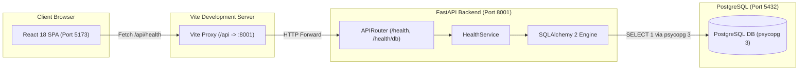

# Platform Architecture &bull; Phase 0 Foundation

## Overview

The **University Learning & Internship Platform** is engineered with a modular, decoupled architecture prioritizing maintainability, strict typing, and high reliability.

Phase 0 establishes the bedrock foundation: configuration management, database connectivity verification, API proxying, automated linting, and testing pipelines.

---

## Component Boundaries

### 1. Backend Layer (`backend/app/`)
- **Core (`core/`)**:
  - `config.py`: Environment-driven settings via `pydantic-settings` reading from project root `.env`.
  - `database.py`: SQLAlchemy 2 engine with connection pooling (`pool_pre_ping=True`) and dependency generator `get_db()`.
  - `exceptions.py`: Domain application exceptions mapped consistently to HTTP status codes.
- **Models (`models/`)**:
  - `base.py`: Central `DeclarativeBase` metadata class wired directly to Alembic autogeneration.
- **Schemas (`schemas/`)**:
  - Pydantic models with frozen immutability and strict serialization contracts.
- **Routers (`routers/`)**:
  - Declarative route endpoints kept thin. No direct SQL queries in router files.
- **Services (`services/`)**:
  - Pure domain and query execution logic (`HealthService`).

### 2. Frontend Layer (`frontend/src/`)
- **API (`api/`)**:
  - HTTP wrappers utilizing native `fetch` targeting relative `/api` paths.
- **Components (`components/`)**:
  - Modular, accessible UI components styled via Tailwind CSS utility classes.
- **Pages (`pages/`)**:
  - Composable layout views.
- **Types (`types/`)**:
  - TypeScript interfaces mirroring backend contracts without using `any`.

---

## Connectivity & Verification Matrix

| Endpoint | Method | Backend Handler | Response Contract | Proxy Target |
| :--- | :--- | :--- | :--- | :--- |
| `/health` | `GET` | `get_health` | `{"status": "ok"}` | `http://localhost:8001/health` |
| `/api/health` | `GET` | `get_health` | `{"status": "ok"}` | `http://localhost:8001/api/health` |
| `/health/db` | `GET` | `get_database_health` | `{"database": "ok"}` | `http://localhost:8001/health/db` |
| `/api/health/db` | `GET` | `get_database_health` | `{"database": "ok"}` | `http://localhost:8001/api/health/db` |
