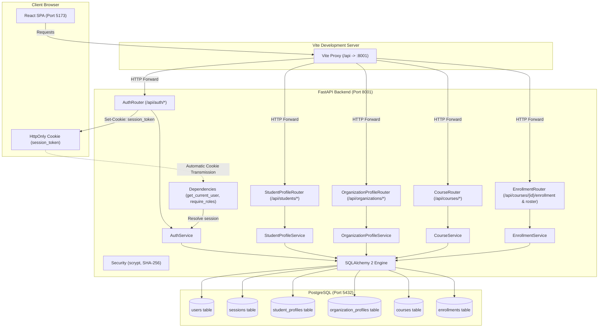

# Platform Architecture &bull; Authentication, Roles, Profiles, Courses &amp; Enrollment

## 1. Overview

The **University Learning & Internship Platform** is engineered with a modular, decoupled architecture prioritizing maintainability, strict typing, and high reliability.

- **Phase 1**: Authentication, session lifecycle, and role-based access control across four primary roles: `student`, `instructor`, `organization`, and `admin`.
- **Phase 2**: Domain profile management:
  - **Student profiles**: academic tracking (university, department, year of study 1-6), bio, and skill inventory.
  - **Organization profiles**: enterprise representation (company name, industry, location, verified website URL, description).
  - **Atomic transactions**: registration automatically creates the role-appropriate profile row in the same transaction.
- **Phase 3**: Courses and Enrollment:
  - **Courses**: instructor-authored learning syllabi with draft/published lifecycle.
  - **Enrollment**: student enrollment and unenrollment in published courses with unique constraints.
  - **Rosters**: instructor and admin visibility into enrolled student names, emails, and enrollment dates.
  - **Discovery**: title search and limit/offset pagination with per-student enrollment flags.

---

## 2. Component Boundaries

### 1. Backend Layer (`backend/app/`)
- **Core (`core/`)**:
  - `config.py`: Environment settings via `pydantic-settings`.
  - `database.py`: SQLAlchemy 2 engine with connection pooling and `get_db()` dependency.
  - `security.py`: Password hashing with stdlib `hashlib.scrypt` and SHA-256 session token hashing.
  - `deps.py`: `get_current_user` and `require_roles(*roles)` enforcing role authorization.
  - `exceptions.py`: Application exceptions mapped to standard HTTP status codes (`NotFoundException`, `ConflictException`, `ForbiddenException`, `UnauthorizedException`).
- **Models (`models/`)**:
  - `user.py`: `User` account model with `UserRole` enum (`student`, `instructor`, `organization`, `admin`).
  - `session.py`: `Session` model with user FK and indexed `token_hash`.
  - `student_profile.py`: `StudentProfile` model with 1-to-1 cascade FK to users.
  - `organization_profile.py`: `OrganizationProfile` model with 1-to-1 cascade FK to users.
  - `course.py`: `Course` model with `CourseStatus` enum (`draft`, `published`), instructor FK, title, description, timestamps.
  - `enrollment.py`: `Enrollment` model linking course and student with unique constraint.
  - `assignment.py`: `Assignment` model with course FK, title, description, timezone-aware `due_at`, `max_points`, timestamps.
  - `submission.py`: `Submission` model linking assignment and student with unique constraint, content, link_url, is_late, grade, feedback, graded_at, graded_by.
  - `base.py`: Central `DeclarativeBase` metadata class.
- **Schemas (`schemas/`)**:
  - `auth.py`: `RegisterRequest`, `LoginRequest`, `UserResponse`.
  - `student_profile.py`: `StudentProfileUpdateRequest`, `StudentProfileResponse`.
  - `organization_profile.py`: `OrganizationProfileUpdateRequest`, `OrganizationProfileResponse`.
  - `course.py`: `CourseCreate` (extra="forbid"), `CourseUpdate` (extra="forbid"), `CourseResponse`, `CourseListResponse`.
  - `enrollment.py`: `EnrolledStudentResponse`, `EnrollmentResponse`, `EnrollmentActionResponse`.
  - `assignment.py`: `AssignmentCreate` (extra="forbid", future due date), `AssignmentUpdate` (extra="forbid"), `AssignmentResponse`.
  - `submission.py`: `SubmissionSubmit` (extra="forbid", http/https validation), `SubmissionGrade` (extra="forbid"), `SubmissionResponse`, `StudentSubmissionRosterItem`.
  - `health.py`: Health verification schemas.
- **Routers (`routers/`)**:
  - Thin FastAPI HTTP endpoints under `/api`.
  - `auth.py`: `/register`, `/login`, `/logout`, `/me`.
  - `student_profile.py`: `/students/me`.
  - `organization_profile.py`: `/organizations/me`.
  - `course.py`: `/courses`, `/courses/{id}`, `/instructors/me/courses`, `/students/me/courses`.
  - `enrollment.py`: `/courses/{id}/enrollment`, `/courses/{id}/students`.
  - `assignment.py`: `/courses/{id}/assignments`, `/assignments/{id}`.
  - `submission.py`: `/assignments/{id}/submission`, `/assignments/{id}/submissions`, `/submissions/{id}/grade`.
- **Services (`services/`)**:
  - `AuthService`: Registration (atomic user + profile), authentication, session lifecycle.
  - `StudentProfileService`: Student profile retrieval and updates.
  - `OrganizationProfileService`: Organization profile retrieval and updates.
  - `course.py`: Course creation, search and pagination, detail lookup with draft visibility guard, update with draft-reversion lock.
  - `enrollment.py`: Course enrollment with duplicate prevention, unenrollment, and roster retrieval.
  - `assignment.py`: Assignment creation, course assignment listing with student submission status mapping, assignment detail lookup, update with max_points grade floor check, and deletion protected against existing submissions.
  - `submission.py`: Student assignment submission with server-clock late flag calculation and locked-after-graded protection, student submission lookup, instructor/admin submissions roster, and instructor grading with max_points bounds.

### 2. Frontend Layer (`frontend/src/`)
- **API (`api/`)**:
  - `auth.ts`, `profile.ts`, `course.ts`, `assignment.ts`, `health.ts`.
- **Context &amp; Navigation (`context/`, `config/`)**:
  - `AuthContext`: Session lifecycle and user identity.
  - `navigation.ts`: Navigation items filtered per role, role-based `getHomePath`.
- **Libraries (`lib/`)**:
  - `cn.ts`: Tailwind class utility.
  - `skills.ts`: Comma-separated skill string parsing.
  - `dates.ts`: Viewer local timezone date formatting, due-soon (3 days), and past-due logic.
- **Components (`components/`)**:
  - `components/courses/`: `CourseForm`, `CourseTable`, `EnrollButton`, `StudentRosterTable`.
  - `components/assignments/`: `AssignmentForm`, `AssignmentTable`, `CourseAssignmentsSection`, `DueBadge`, `GradeForm`, `SubmissionForm`, `SubmissionStatusBadge`, `SubmissionsTable`.
  - `components/ui/`: `Button`, `TextField`, `Textarea`, `Select`, `Badge`, `DataTable`, `EmptyState`, `ErrorMessage`, `Notice`, `PageHeader`.
  - `components/layout/`: `AppShell`.
  - `components/routes/`: `ProtectedRoute`, `RoleRoute`.
- **Pages (`pages/`)**:
  - `/courses`: Course catalogue with title search, pagination, and admin status badges.
  - `/my-courses`: Role-specific view (student enrolled courses; instructor courses with "New course" button).
  - `/courses/new`: Instructor course creation form.
  - `/courses/:id/edit`: Instructor/admin course editing form.
  - `/courses/:id`: Course detail view with student enroll/leave button, owner publishing, student roster table, and course assignments section.
  - `/courses/:courseId/assignments/new`: Instructor assignment creation form.
  - `/assignments/:id/edit`: Instructor assignment editing form.
  - `/assignments/:id`: Assignment detail view with student submission form / locked grade or instructor submissions roster.
  - `/assignments/:assignmentId/submissions/:submissionId/grade`: Instructor grading page.
  - `/profile`: Role-specific student and organization profile views.
  - `/account`: Account details and credentials overview.
  - `/status`: Admin system status view.

---

## 3. Endpoints Matrix

| Endpoint | Method | Role Access | Description | Success Code |
| :--- | :--- | :--- | :--- | :--- |
| `/api/auth/register` | `POST` | Public | Register student or organization (atomic profile creation) | `201 Created` |
| `/api/auth/login` | `POST` | Public | Authenticate credentials &amp; start session | `200 OK` |
| `/api/auth/logout` | `POST` | Public | Terminate session &amp; clear cookie | `200 OK` |
| `/api/auth/me` | `GET` | Authenticated | Retrieve current user profile | `200 OK` |
| `/api/students/me` | `GET` | `student` | Retrieve authenticated student profile | `200 OK` |
| `/api/students/me` | `PUT` | `student` | Update authenticated student profile | `200 OK` |
| `/api/organizations/me` | `GET` | `organization` | Retrieve authenticated organization profile | `200 OK` |
| `/api/organizations/me` | `PUT` | `organization` | Update authenticated organization profile | `200 OK` |
| `/api/courses` | `POST` | `instructor` | Create course owned by authenticated instructor | `201 Created` |
| `/api/courses` | `GET` | Authenticated | List published courses (or all for admin) with ?q= and pagination | `200 OK` |
| `/api/courses/{id}` | `GET` | Authenticated | Get course details (visible if published, owned, or admin) | `200 OK` |
| `/api/courses/{id}` | `PATCH` | `instructor` (owner), `admin` | Update course title, description, or publish | `200 OK` |
| `/api/instructors/me/courses` | `GET` | `instructor` | Get instructor's own courses with enrolled count | `200 OK` |
| `/api/students/me/courses` | `GET` | `student` | Get student's enrolled courses | `200 OK` |
| `/api/courses/{id}/students` | `GET` | `instructor` (owner), `admin` | Get enrolled student roster with names and emails | `200 OK` |
| `/api/courses/{id}/enrollment` | `POST` | `student` | Enroll student in published course | `201 Created` |
| `/api/courses/{id}/enrollment` | `DELETE` | `student` | Unenroll student from course | `200 OK` |
| `/api/courses/{id}/assignments` | `POST` | `instructor` (owner) | Create assignment with future due date | `201 Created` |
| `/api/courses/{id}/assignments` | `GET` | `instructor` (owner), `admin`, `student` (enrolled) | List course assignments (with student submission state) | `200 OK` |
| `/api/assignments/{id}` | `GET` | `instructor` (owner), `admin`, `student` (enrolled) | Get single assignment details | `200 OK` |
| `/api/assignments/{id}` | `PATCH` | `instructor` (owner) | Update assignment (max_points floor checked) | `200 OK` |
| `/api/assignments/{id}` | `DELETE` | `instructor` (owner) | Delete assignment (409 if submissions exist) | `204 No Content` |
| `/api/assignments/{id}/submission` | `PUT` | `student` (enrolled) | Submit or update coursework (late computed, 409 if graded) | `200 OK` |
| `/api/assignments/{id}/submission` | `GET` | `student` (enrolled) | Get student's own submission | `200 OK` |
| `/api/assignments/{id}/submissions` | `GET` | `instructor` (owner), `admin` | List every enrolled student with submission or null | `200 OK` |
| `/api/submissions/{id}/grade` | `PUT` | `instructor` (owner) | Grade submission (0 to max_points, feedback, regradable) | `200 OK` |
| `/api/health` | `GET` | Public | Basic platform status probe | `200 OK` |
| `/api/health/db` | `GET` | Public | Database query connectivity probe | `200 OK` |
