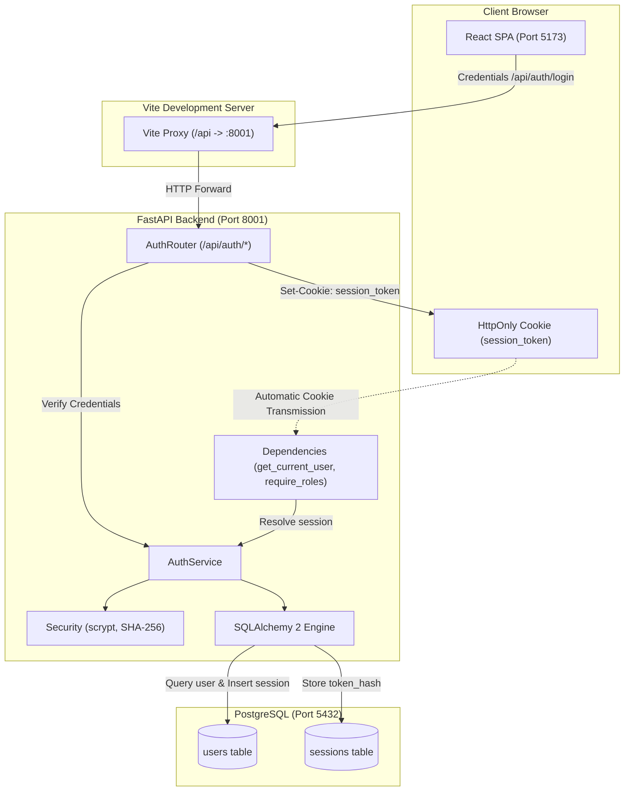

# Platform Architecture &bull; Authentication &amp; Platform Foundation

## 1. Overview

The **University Learning & Internship Platform** is engineered with a modular, decoupled architecture prioritizing maintainability, strict typing, and high reliability.

Phase 1 establishes authentication, session lifecycle, and role-based access control across four primary roles: `student`, `instructor`, `organization`, and `admin`.

---

## 2. Component Boundaries

### 1. Backend Layer (`backend/app/`)
- **Core (`core/`)**:
  - `config.py`: Environment-driven settings via `pydantic-settings` reading from project root `.env`, including `COOKIE_SECURE`.
  - `database.py`: SQLAlchemy 2 engine with connection pooling (`pool_pre_ping=True`) and dependency generator `get_db()`.
  - `security.py`: Password hashing with stdlib `hashlib.scrypt`, constant-time timing defense on login, and SHA-256 session token hashing.
  - `deps.py`: `get_current_user` resolving active session from cookie and `require_roles(*roles)` enforcing role authorization.
  - `exceptions.py`: Domain application exceptions mapped consistently to standard HTTP status codes and codes.
- **Models (`models/`)**:
  - `user.py`: `User` account model with `UserRole` enum (`student`, `instructor`, `organization`, `admin`).
  - `session.py`: `Session` model with `user_id` foreign key (cascade delete) and indexed `token_hash`.
  - `base.py`: Central `DeclarativeBase` metadata class wired directly to Alembic autogeneration.
- **Schemas (`schemas/`)**:
  - `auth.py`: `RegisterRequest`, `LoginRequest`, and `UserResponse` (never exposes `password_hash` or tokens).
  - `health.py`: Health verification schemas.
- **Routers (`routers/`)**:
  - Thin FastAPI HTTP endpoints under `/api`. No business or database logic directly in router functions.
- **Services (`services/`)**:
  - Pure domain rules: `AuthService` handles registration, timing-safe authentication, session issuance, and session revocation.

### 2. Frontend Layer (`frontend/src/`)
- **API (`api/`)**:
  - `auth.ts`: HTTP wrappers for `/api/auth` endpoints with credentials included.
  - `health.ts`: System and database health probes.
- **Context &amp; Hooks (`context/`, `hooks/`)**:
  - `AuthContext`: Initial session probe on load (`/api/auth/me`), state storage, and login/register/logout actions.
  - `useAuth`: Hook accessing authenticated user context.
- **Routes &amp; Guards (`components/routes/`)**:
  - `ProtectedRoute`: Redirects unauthenticated traffic to `/login`.
  - `RoleRoute`: Renders plain access restricted notice for unauthorized roles.
- **Components (`components/`)**:
  - UI library adhering to platform design tokens (Button, TextField, Select, Badge, Notice, etc.).
- **Pages (`pages/`)**:
  - `/login`: Public centered login form.
  - `/register`: Public centered registration form with student/organization selection.
  - `/account`: Protected user profile view.
  - `/`: Admin-only system status dashboard.

---

## 3. Endpoints Matrix

| Endpoint | Method | Role Access | Description | Success Code |
| :--- | :--- | :--- | :--- | :--- |
| `/api/auth/register` | `POST` | Public | Register student or organization | `201 Created` |
| `/api/auth/login` | `POST` | Public | Authenticate credentials &amp; start session | `200 OK` |
| `/api/auth/logout` | `POST` | Public | Terminate session &amp; clear cookie | `200 OK` |
| `/api/auth/me` | `GET` | Authenticated | Retrieve current user profile | `200 OK` |
| `/api/health` | `GET` | Public | Basic platform status probe | `200 OK` |
| `/api/health/db` | `GET` | Public | Database query connectivity probe | `200 OK` |
