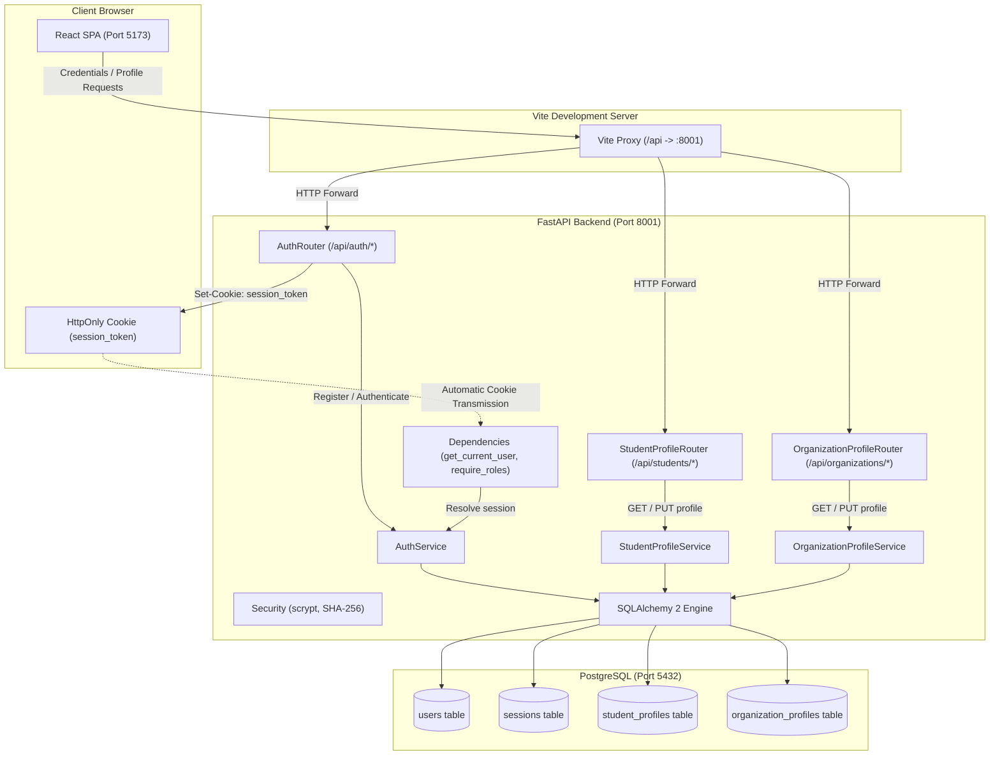

# Platform Architecture &bull; Authentication, Roles &amp; Profiles

## 1. Overview

The **University Learning & Internship Platform** is engineered with a modular, decoupled architecture prioritizing maintainability, strict typing, and high reliability.

Phase 1 establishes authentication, session lifecycle, and role-based access control across four primary roles: `student`, `instructor`, `organization`, and `admin`.

Phase 2 establishes domain profile management:
- **Student profiles**: academic tracking (university, department, year of study 1-6), bio, and skill inventory.
- **Organization profiles**: enterprise representation (company name, industry, location, verified website URL, description).
- **Atomic transactions**: registration automatically creates the role-appropriate profile row in the same transaction.
- **Session-bound identity**: profile endpoints derive identity exclusively from authenticated server session cookies, rejecting arbitrary user IDs with 422.

---

## 2. Component Boundaries

### 1. Backend Layer (`backend/app/`)
- **Core (`core/`)**:
  - `config.py`: Environment-driven settings via `pydantic-settings` reading from project root `.env`, including `COOKIE_SECURE`.
  - `database.py`: SQLAlchemy 2 engine with connection pooling (`pool_pre_ping=True`) and dependency generator `get_db()`.
  - `security.py`: Password hashing with stdlib `hashlib.scrypt`, constant-time timing defense on login, and SHA-256 session token hashing.
  - `deps.py`: `get_current_user` resolving active session from cookie and `require_roles(*roles)` enforcing role authorization.
  - `exceptions.py`: Domain application exceptions mapped consistently to standard HTTP status codes and codes.
- **Models (`models/`)**:
  - `user.py`: `User` account model with `UserRole` enum (`student`, `instructor`, `organization`, `admin`).
  - `session.py`: `Session` model with `user_id` foreign key (cascade delete) and indexed `token_hash`.
  - `student_profile.py`: `StudentProfile` model with 1-to-1 cascade FK to users, year of study check constraint (1-6), and skills array.
  - `organization_profile.py`: `OrganizationProfile` model with 1-to-1 cascade FK to users and company profile fields.
  - `base.py`: Central `DeclarativeBase` metadata class wired directly to Alembic autogeneration.
- **Schemas (`schemas/`)**:
  - `auth.py`: `RegisterRequest` (with required `organization_name` for org accounts), `LoginRequest`, and `UserResponse`.
  - `student_profile.py`: `StudentProfileUpdateRequest` (`extra="forbid"`, skill and year validation) and `StudentProfileResponse`.
  - `organization_profile.py`: `OrganizationProfileUpdateRequest` (`extra="forbid"`, URL and length validation) and `OrganizationProfileResponse`.
  - `health.py`: Health verification schemas.
- **Routers (`routers/`)**:
  - Thin FastAPI HTTP endpoints under `/api`. No business or database logic directly in router functions.
  - `auth.py`: Public auth endpoints (`/register`, `/login`, `/logout`, `/me`).
  - `student_profile.py`: Student profile endpoints (`/students/me`).
  - `organization_profile.py`: Organization profile endpoints (`/organizations/me`).
- **Services (`services/`)**:
  - Pure domain rules:
    - `AuthService`: Registration (atomic user + profile insertion), timing-safe authentication, session lifecycle.
    - `StudentProfileService`: Student profile retrieval and updates with whitespace normalization.
    - `OrganizationProfileService`: Organization profile retrieval and updates with URL validation.

### 2. Frontend Layer (`frontend/src/`)
- **API (`api/`)**:
  - `auth.ts`: HTTP wrappers for `/api/auth` endpoints with credentials included.
  - `profile.ts`: HTTP wrappers for `/api/students/me` and `/api/organizations/me`.
  - `health.ts`: System and database health probes.
- **Context &amp; Hooks (`context/`, `hooks/`)**:
  - `AuthContext`: Initial session probe on load (`/api/auth/me`), state storage, and login/register/logout actions.
  - `useAuth`: Hook accessing authenticated user context.
- **Routes &amp; Guards (`components/routes/`)**:
  - `ProtectedRoute`: Redirects unauthenticated traffic to `/login`.
  - `RoleRoute`: Renders plain access restricted notice for unauthorized roles.
- **Components (`components/`)**:
  - UI library adhering to platform design tokens (Button, TextField, Select, Textarea, Badge, Notice, etc.).
- **Pages (`pages/`)**:
  - `/login`: Public centered login form.
  - `/register`: Public centered registration form with role selection and dynamic Organization name field.
  - `/profile`: Protected role-specific profile form for students (academic details, skills) and organizations (name, website, industry).
  - `/account`: Protected user account summary (credentials, role, status).
  - `/status`: Admin-only system status dashboard (`SystemStatusPage`).
  - `/`: Root redirect to /login (unauthenticated) or role home page (authenticated).

---

## 3. Endpoints Matrix

| Endpoint | Method | Role Access | Description | Success Code |
| :--- | :--- | :--- | :--- | :--- |
| `/api/auth/register` | `POST` | Public | Register student or organization (atomic profile creation) | `201 Created` |
| `/api/auth/login` | `POST` | Public | Authenticate credentials &amp; start session | `200 OK` |
| `/api/auth/logout` | `POST` | Public | Terminate session &amp; clear cookie | `200 OK` |
| `/api/auth/me` | `GET` | Authenticated | Retrieve current user profile | `200 OK` |
| `/api/students/me` | `GET` | `student` | Retrieve authenticated student profile | `200 OK` |
| `/api/students/me` | `PUT` | `student` | Update authenticated student profile | `200 OK` |
| `/api/organizations/me` | `GET` | `organization` | Retrieve authenticated organization profile | `200 OK` |
| `/api/organizations/me` | `PUT` | `organization` | Update authenticated organization profile | `200 OK` |
| `/api/health` | `GET` | Public | Basic platform status probe | `200 OK` |
| `/api/health/db` | `GET` | Public | Database query connectivity probe | `200 OK` |
