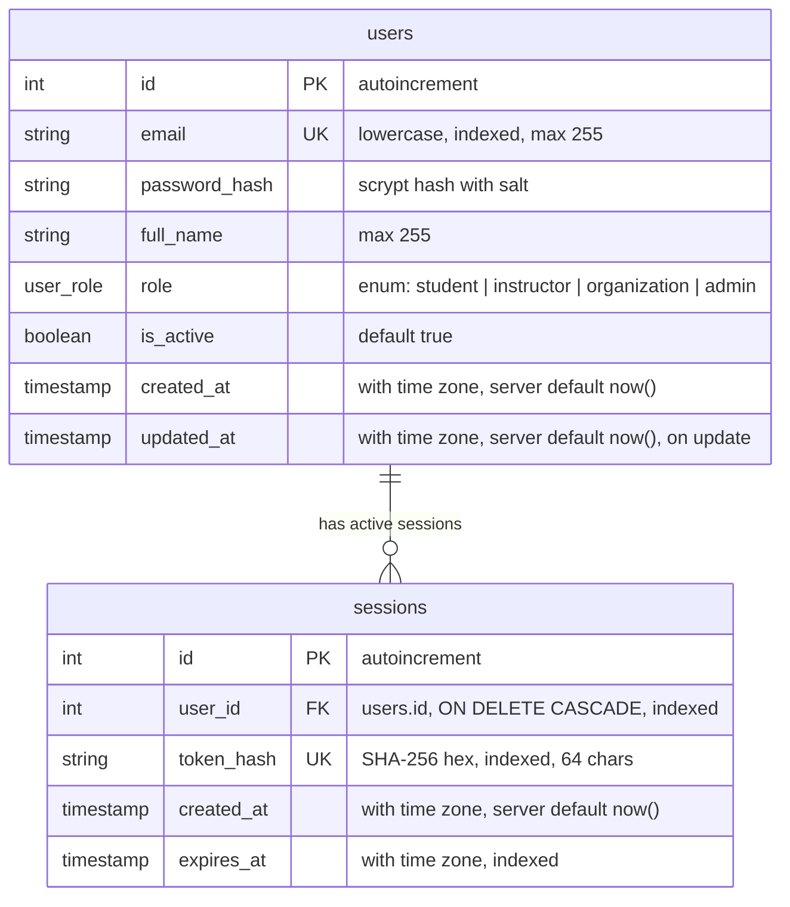

# Database Architecture &bull; Entity Relationship Specification

This document details the PostgreSQL schema managed via SQLAlchemy 2 declarative models and Alembic migrations.

---

## 1. Entity-Relationship Diagram

---

## 2. Table Specifications

### `users`

Represents all registered accounts across all roles in the platform.

| Column | Type | Constraints | Description |
| :--- | :--- | :--- | :--- |
| `id` | `INTEGER` | `PRIMARY KEY`, `AUTOINCREMENT` | Unique identifier for user account |
| `email` | `VARCHAR(255)` | `NOT NULL`, `UNIQUE`, `INDEX` | Normalized lowercase email address |
| `password_hash` | `VARCHAR(255)` | `NOT NULL` | `hashlib.scrypt` hash with unique random salt |
| `full_name` | `VARCHAR(255)` | `NOT NULL` | Display and legal name of the user |
| `role` | `user_role` | `NOT NULL` | PostgreSQL native enum (`student`, `instructor`, `organization`, `admin`) |
| `is_active` | `BOOLEAN` | `NOT NULL`, `DEFAULT TRUE` | Account active state for suspension / activation |
| `created_at` | `TIMESTAMPTZ` | `NOT NULL`, `DEFAULT now()` | Account creation timestamp in UTC |
| `updated_at` | `TIMESTAMPTZ` | `NOT NULL`, `DEFAULT now()` | Last update timestamp in UTC |

### `sessions`

Represents active authentication sessions backed by HttpOnly cookies.

| Column | Type | Constraints | Description |
| :--- | :--- | :--- | :--- |
| `id` | `INTEGER` | `PRIMARY KEY`, `AUTOINCREMENT` | Unique session record identifier |
| `user_id` | `INTEGER` | `NOT NULL`, `FK users(id) ON DELETE CASCADE`, `INDEX` | Owning account reference |
| `token_hash` | `VARCHAR(64)` | `NOT NULL`, `UNIQUE`, `INDEX` | SHA-256 hex digest of the raw session token |
| `created_at` | `TIMESTAMPTZ` | `NOT NULL`, `DEFAULT now()` | Session inception timestamp in UTC |
| `expires_at` | `TIMESTAMPTZ` | `NOT NULL`, `INDEX` | Session expiry timestamp in UTC (default 7 days) |

---

## 3. Security &amp; Data Integrity Rules

1. **Token Storage**: Raw session tokens are never stored in the database. Only the SHA-256 digest is persisted in `sessions.token_hash`.
2. **Credential Privacy**: `password_hash` is never included in API responses or logs.
3. **Cascade Invalidation**: Deleting a user account cascades to automatically drop all active sessions associated with that user.
4. **Stale Session Purging**: Expired sessions are checked against `expires_at` and automatically deleted upon access resolution.
