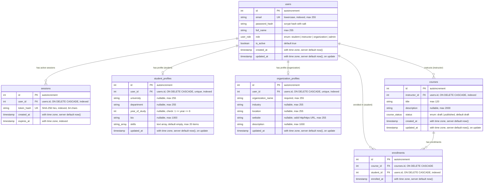

# Database Architecture &bull; Entity Relationship Specification

This document details the PostgreSQL schema managed via SQLAlchemy 2 declarative models and Alembic migrations.

---

## 1. Entity-Relationship Diagram

---

## 2. Table Specifications

### `users`

Represents all registered accounts across all roles in the platform.

| Column | Type | Constraints | Description |
| :--- | :--- | :--- | :--- |
| `id` | `INTEGER` | `PRIMARY KEY`, `AUTOINCREMENT` | Unique identifier for user account |
| `email` | `VARCHAR(255)` | `NOT NULL`, `UNIQUE`, `INDEX` | Normalized lowercase email address |
| `password_hash` | `VARCHAR(255)` | `NOT NULL` | `hashlib.scrypt` hash with unique random salt |
| `full_name` | `VARCHAR(255)` | `NOT NULL` | Display and legal name of the user |
| `role` | `user_role` | `NOT NULL` | PostgreSQL native enum (`student`, `instructor`, `organization`, `admin`) |
| `is_active` | `BOOLEAN` | `NOT NULL`, `DEFAULT TRUE` | Account active state for suspension / activation |
| `created_at` | `TIMESTAMPTZ` | `NOT NULL`, `DEFAULT now()` | Account creation timestamp in UTC |
| `updated_at` | `TIMESTAMPTZ` | `NOT NULL`, `DEFAULT now()` | Last update timestamp in UTC |

### `sessions`

Represents active authentication sessions backed by HttpOnly cookies.

| Column | Type | Constraints | Description |
| :--- | :--- | :--- | :--- |
| `id` | `INTEGER` | `PRIMARY KEY`, `AUTOINCREMENT` | Unique session record identifier |
| `user_id` | `INTEGER` | `NOT NULL`, `FK users(id) ON DELETE CASCADE`, `INDEX` | Owning account reference |
| `token_hash` | `VARCHAR(64)` | `NOT NULL`, `UNIQUE`, `INDEX` | SHA-256 hex digest of the raw session token |
| `created_at` | `TIMESTAMPTZ` | `NOT NULL`, `DEFAULT now()` | Session inception timestamp in UTC |
| `expires_at` | `TIMESTAMPTZ` | `NOT NULL`, `INDEX` | Session expiry timestamp in UTC (default 7 days) |

### `student_profiles`

Represents optional academic background and skills profile for student accounts.

| Column | Type | Constraints | Description |
| :--- | :--- | :--- | :--- |
| `id` | `INTEGER` | `PRIMARY KEY`, `AUTOINCREMENT` | Unique profile identifier |
| `user_id` | `INTEGER` | `NOT NULL`, `UNIQUE`, `FK users(id) ON DELETE CASCADE`, `INDEX` | Owning student user account |
| `university` | `VARCHAR(255)` | `NULLABLE` | Attending university or institution |
| `department` | `VARCHAR(255)` | `NULLABLE` | Faculty or academic department |
| `year_of_study` | `INTEGER` | `NULLABLE`, `CHECK (1 <= year_of_study <= 6)` | Academic progress year (1 to 6) |
| `bio` | `VARCHAR(1000)` | `NULLABLE` | Student background and career interests |
| `skills` | `VARCHAR(40)[]` | `NOT NULL`, `DEFAULT '{}'` | Array of up to 20 skill tags |
| `updated_at` | `TIMESTAMPTZ` | `NOT NULL`, `DEFAULT now()` | Profile last modification timestamp |

### `organization_profiles`

Represents company details, industry sector, and contact points for organization accounts.

| Column | Type | Constraints | Description |
| :--- | :--- | :--- | :--- |
| `id` | `INTEGER` | `PRIMARY KEY`, `AUTOINCREMENT` | Unique profile identifier |
| `user_id` | `INTEGER` | `NOT NULL`, `UNIQUE`, `FK users(id) ON DELETE CASCADE`, `INDEX` | Owning organization user account |
| `organization_name` | `VARCHAR(255)` | `NOT NULL` | Required name of the organization |
| `industry` | `VARCHAR(255)` | `NULLABLE` | Operating industry or business vertical |
| `location` | `VARCHAR(255)` | `NULLABLE` | Office city, country, or location |
| `website` | `VARCHAR(255)` | `NULLABLE` | Valid HTTP or HTTPS web URL |
| `description` | `VARCHAR(1000)` | `NULLABLE` | Organization mission, culture, and overview |
| `updated_at` | `TIMESTAMPTZ` | `NOT NULL`, `DEFAULT now()` | Profile last modification timestamp |

### `courses`

Represents instructor-created learning courses with draft/published lifecycle.

| Column | Type | Constraints | Description |
| :--- | :--- | :--- | :--- |
| `id` | `INTEGER` | `PRIMARY KEY`, `AUTOINCREMENT` | Unique course identifier |
| `instructor_id` | `INTEGER` | `NOT NULL`, `FK users(id) ON DELETE CASCADE`, `INDEX` | Owning instructor user account |
| `title` | `VARCHAR(120)` | `NOT NULL` | Course title (3 to 120 characters) |
| `description` | `VARCHAR(2000)` | `NULLABLE` | Syllabus and course outline |
| `status` | `course_status` | `NOT NULL`, `DEFAULT 'draft'` | Enum status (`draft`, `published`) |
| `created_at` | `TIMESTAMPTZ` | `NOT NULL`, `DEFAULT now()` | Creation timestamp in UTC |
| `updated_at` | `TIMESTAMPTZ` | `NOT NULL`, `DEFAULT now()` | Last update timestamp in UTC |

### `enrollments`

Represents student enrollment linking a student account to a course.

| Column | Type | Constraints | Description |
| :--- | :--- | :--- | :--- |
| `id` | `INTEGER` | `PRIMARY KEY`, `AUTOINCREMENT` | Unique enrollment identifier |
| `course_id` | `INTEGER` | `NOT NULL`, `FK courses(id) ON DELETE CASCADE` | Course reference |
| `student_id` | `INTEGER` | `NOT NULL`, `FK users(id) ON DELETE CASCADE`, `INDEX` | Enrolled student user reference |
| `enrolled_at` | `TIMESTAMPTZ` | `NOT NULL`, `DEFAULT now()` | Enrollment timestamp in UTC |
| &mdash; | &mdash; | `UNIQUE (course_id, student_id)` | Prevents duplicate student enrollments |

---

## 3. Security &amp; Data Integrity Rules

1. **Token Storage**: Raw session tokens are never stored in the database. Only the SHA-256 digest is persisted in `sessions.token_hash`.
2. **Credential Privacy**: `password_hash` is never included in API responses or logs.
3. **Cascade Invalidation**: Deleting a user account cascades to automatically drop all active sessions, associated profile records (`student_profiles` or `organization_profiles`), created courses (for instructors), and enrollments (for students).
4. **Stale Session Purging**: Expired sessions are checked against `expires_at` and automatically deleted upon access resolution.
5. **Atomic Registration Transaction**: User creation and initial profile creation occur in the same database transaction; failure of either rolls back both.
6. **Session-Bound Identity**: Endpoints resolving profiles, creating courses, or enrolling students derive user identity solely from the verified session, never allowing external modification or spoofing of foreign keys.
7. **One-Way Status Transition**: Courses can transition from `draft` to `published`, but published courses cannot be reverted to `draft` (enforced with 409 Conflict).
8. **Unique Enrollment**: Unique constraint on `(course_id, student_id)` prevents double-enrollment, backed by 409 Conflict handling.
