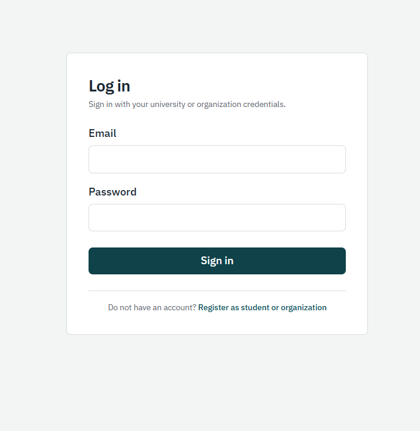
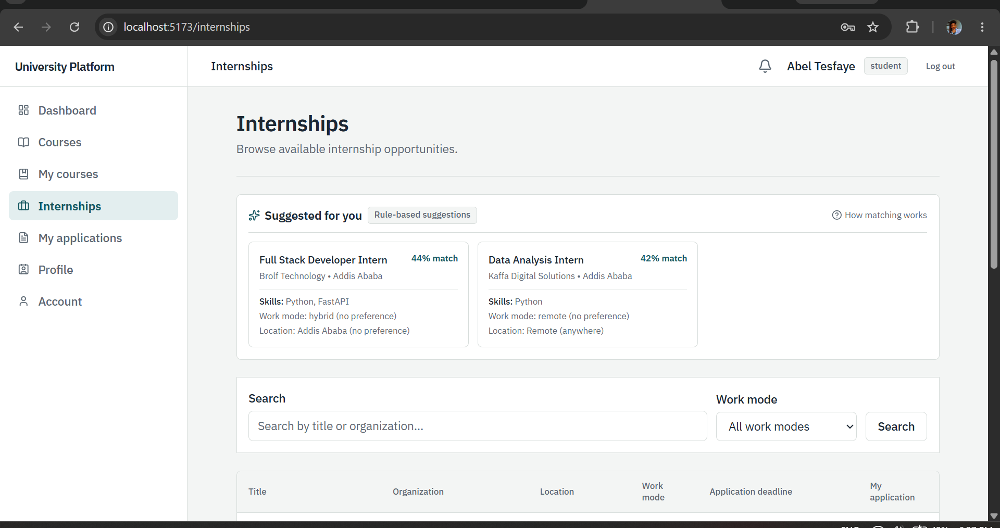
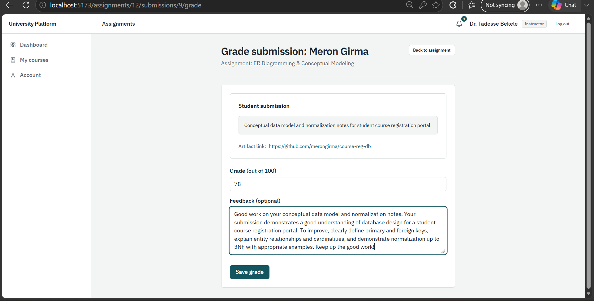
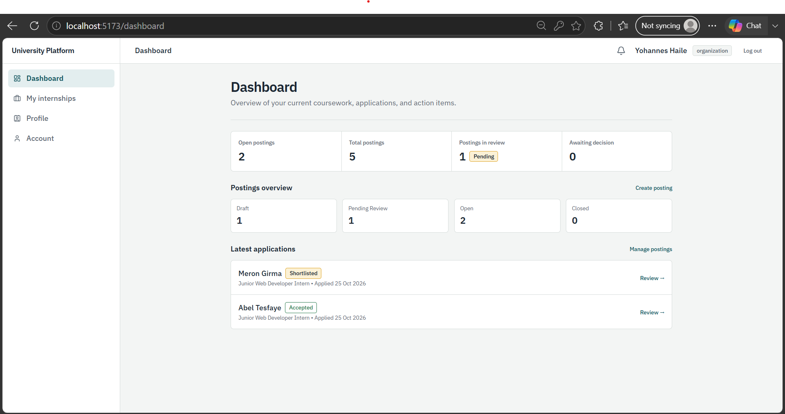
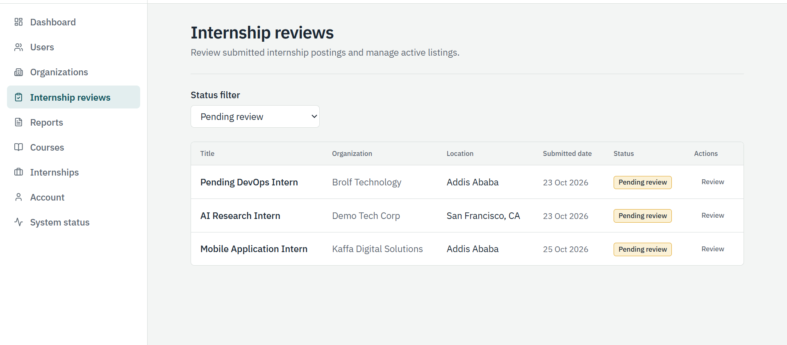
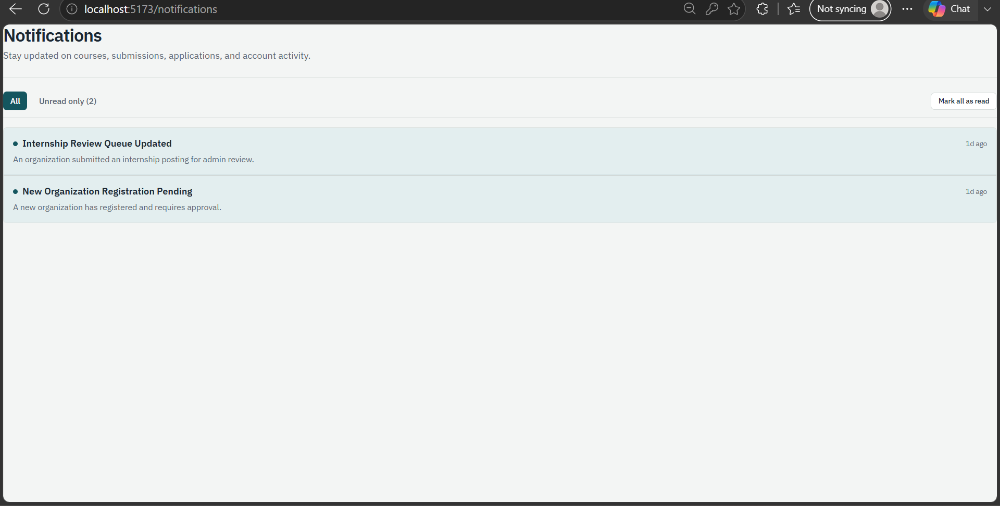
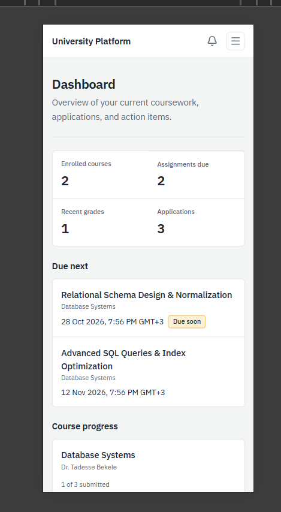

# End-User Guide &bull; University Learning &amp; Internship Platform

This guide provides step-by-step instructions for evaluating and operating the platform across each user role (**Student**, **Instructor**, **Organization**, and **Administrator**). All scenarios are designed to work seamlessly with the pre-seeded demo dataset.

---

## 1. Getting Started &amp; Authentication

### Running the Services
Ensure both backend and frontend development servers are running:
- **Backend API**: `http://localhost:8001` (FastAPI with OpenAPI docs at `/docs`)
- **Frontend SPA**: `http://localhost:5173` (Vite + React)

### Logging In
1. Navigate to [http://localhost:5173/login](http://localhost:5173/login).
2. Enter the email corresponding to the role you wish to test.
3. Enter the standard evaluation demo password: `12345678` (demo-only).
4. Click **Sign in**. The application will authenticate your session and route you directly to your role-specific dashboard.

### Pre-Seeded Demo Accounts Reference

All demo accounts are provisioned via `scripts/seed_demo.py`. For local evaluation, all demo accounts share the password `12345678` (demo-only and intentionally public).

| Name | Role | Email | Password | Profile State | What This Account Demonstrates |
| :--- | :--- | :--- | :--- | :--- | :--- |
| **Dr. Mulugeta Assefa** | Admin | `mulugeta.assefa@example.com` | `12345678` | Complete | Administrative dashboard, user provisioning and password resets, organization registration approvals, internship moderation review queue, and listing takedowns. |
| **Ms. Selamawit Tadesse** | Coordinator | `selamawit.tadesse@example.com` | `12345678` | Complete | Coordinator dashboard, organization registration review and approvals, internship moderation review queue, listing takedowns, and read-only applicant roster inspection. |
| **Dr. Tadesse Bekele** | Instructor | `tadesse.bekele@example.com` | `12345678` | Complete | Instructor dashboard, courses "Database Systems" (published) and "Introduction to Programming" (published), assignment authoring, and student submission grading. |
| **Ms. Hana Worku** | Instructor | `hana.worku@example.com` | `12345678` | Complete | Course authoring in draft state ("Software Engineering"), curriculum planning, and department course rosters. |
| **Abel Tesfaye** | Student | `abel.tesfaye@example.com` | `12345678` | Complete | Student dashboard, course progress, submitted ER Diagramming assignment (graded 100/100 with instructor feedback), accepted internship offer from Kaffa Digital Solutions, rejected application, and withdrawn application. |
| **Meron Girma** | Student | `meron.girma@example.com` | `12345678` | Complete | Student dashboard, course progress, late assignment submission awaiting instructor grading, shortlisted internship candidate at Kaffa Digital Solutions. |
| **Dawit Lemma** | Student | `dawit.lemma@example.com` | `12345678` | Incomplete | Incomplete profile demonstration showing the profile completion banner and the profile-complete rule before applying (blocking internship applications until university and department are saved); submitted application to Network Support Intern. |
| **Kaffa Digital Solutions** (Yohannes Haile) | Organization | `yohannes.haile@example.com` | `12345678` | Approved | Organization dashboard, postings across lifecycles (`open`, `pending_review`, `draft`, `rejected`), applicant hiring pipeline (accepted Abel Tesfaye, shortlisted Meron Girma). |
| **Gibe Valley Telecom Services** (Rahel Desta) | Organization | `rahel.desta@example.com` | `12345678` | Approved | Organization dashboard, network support and systems administration postings, candidate rejection decision, and closed listing. |
| **Abay Data Labs** (Eyob Kassa) | Organization | `eyob.kassa@example.com` | `12345678` | Pending Approval | Pending approval banner demonstration; can create and edit draft postings, but submitting for review or publishing is blocked until an administrator or coordinator reviews and approves the organization profile. |

---

## 2. Student Role Guide

### Demo Accounts
- **Ready Student**: Abel Tesfaye (`abel.tesfaye@example.com`, complete profile, enrolled courses, existing submissions)
- **Ready Student**: Meron Girma (`meron.girma@example.com`, complete profile, enrolled courses, late submission)
- **Incomplete Profile Student**: Dawit Lemma (`dawit.lemma@example.com`, incomplete profile demonstrating the profile-complete rule before applying)

### Step 1: Explore the Student Dashboard (`/`)
1. Log in as `abel.tesfaye@example.com`.
2. Notice the top stat strip displaying:
   - **Enrolled Courses** total (e.g., 2 courses).
   - **Pending Assignments** count.
   - **Active Applications** in your career pipeline.
3. Review the **Assignments Due Soon** panel:
   - "Relational Schema Design &amp; Normalization" due in 3 days displays an urgent badge.
   - "Advanced SQL Queries &amp; Index Optimization" due in 18 days displays an upcoming badge.
   - "ER Diagramming &amp; Conceptual Modeling" past due displays a past due badge.
4. Review the **Recent Grades** panel showing scored assignments with percentage chips and instructor feedback (e.g., 100% on ER Diagramming).

### Step 2: Browse &amp; Enroll in Courses (`/courses`)
1. Click **Courses** in the main navigation.
2. Use the search bar to filter by course title (e.g., "Database Systems"), code, or department.
3. Click on a course card to view the **Course Details** page.
4. Review the syllabus outline, instructor information (Dr. Tadesse Bekele), and assignment list.
5. Click **Enroll** to join a course (or **Leave Course** to unenroll). Duplicate enrollments are prevented by backend database constraints.

### Step 3: Complete &amp; Submit Assignments (`/assignments/:id`)
1. From a course detail page or your dashboard, click an assignment title.
2. Read the assignment instructions, deadline timestamp, and maximum score.
3. If submitting before the deadline, enter your response and project repository URL in the **Submission Text** area and click **Submit Assignment**.
4. Log in as `meron.girma@example.com` to observe a late submission tagged with a red **Late** badge.
5. Once the instructor grades your submission, notice that your score and comments appear, and further edits are strictly locked.

### Step 4: Manage Profile &amp; Preferences (`/profile`)
1. Log in as `abel.tesfaye@example.com`. Click your name in the top navigation and select **Profile**.
2. Notice your profile attributes: Jimma University, Information Technology, Year 4, and technical skills tags (`Python`, `FastAPI`, `React`, `PostgreSQL`, `Docker`, `Git`).
3. Notice your internship preferences: preferred work arrangements (**Hybrid**, **On-site**) and target locality (**Addis Ababa**). Students can update these preferences at any time to tune matching results.
4. **Profile-Complete Rule Test**: Log in as `dawit.lemma@example.com`. Notice the warning banner stating your profile is incomplete (missing university and department). Navigate to `/internships`, select an internship, and observe that submitting an application is blocked until your university and department profile fields are completed.

### Step 5: Explore Suggested Internships &amp; Apply (`/internships`)
1. Log in as `abel.tesfaye@example.com`.
2. Review the **Suggested for you** card deck at the top of the **Internships** catalog and on your Student Dashboard:
   - Notice the match score chip (e.g., `72% match`) and matched skills list (`Python`, `FastAPI`).
   - Notice matching reasons confirming preferred work mode and location alignments.
   - Click **How matching works** to inspect the transparent point allocation breakdown (up to 60 pts skills, 20 pts work mode, 20 pts location).
3. Filter the broader catalog by work mode: **Remote**, **Hybrid**, or **On-site**, or search by keyword.
4. Select an active listing and click **Apply**.
5. Fill in your personalized cover letter and submit your application.
6. Navigate to **My Applications** (`/my-applications`) to monitor review statuses:
   - Junior Web Developer Intern: **Accepted**
   - Network Support Intern: **Rejected**
   - Systems Administration Intern 2025: **Withdrawn**

---

## 3. Instructor Role Guide

### Demo Accounts
- **Course Instructor**: Dr. Tadesse Bekele (`tadesse.bekele@example.com`)
- **Curriculum Instructor**: Ms. Hana Worku (`hana.worku@example.com`)

### Step 1: Review the Instructor Dashboard (`/`)
1. Log in as `tadesse.bekele@example.com`.
2. The dashboard highlights:
   - **Active Courses** published (Database Systems, Introduction to Programming).
   - **Total Enrolled Students** across all courses.
   - **Needs Grading** count of student submissions awaiting evaluation (Meron Girma's submission).
3. Click any submission in the "Needs Grading" list to jump directly to the grading interface.

### Step 2: Create &amp; Manage Courses (`/courses/new`)
1. Click **Courses** &rarr; **Create Course** (or access via the dashboard quick action).
2. Enter the course code (e.g., `IT302`), title, department, and comprehensive syllabus text.
3. Choose the initial status: `draft` (hidden from students) or `published` (visible in catalog).
4. Save the course. On the course detail page, view the **Enrolled Students Roster** showing enrolled student names, emails, and enrollment dates.

### Step 3: Create Course Assignments (`/courses/:id`)
1. On your course detail page, click **New Assignment**.
2. Enter the assignment title, detailed instructions, due date, and maximum possible points (e.g., `100`).
3. Click **Create Assignment**. The assignment becomes immediately available to all enrolled students.

### Step 4: Grade Student Submissions (`/submissions/:id/grade`)
1. Open "Database Systems", select "ER Diagramming &amp; Conceptual Modeling", and scroll to the **Submissions Roster**.
2. Meron Girma's submission displays a yellow **Pending Review** badge.
3. Click **Grade** next to the submission.
4. Enter a numeric grade (enforced between `0` and `max_score`) and enter constructive instructor feedback.
5. Click **Submit Grade**. The submission status transitions to `graded`, and the student's dashboard updates immediately.

---

## 4. Organization Role Guide

### Demo Accounts
- **Approved Organization**: Kaffa Digital Solutions (Yohannes Haile, `yohannes.haile@example.com`)
- **Approved Organization**: Gibe Valley Telecom Services (Rahel Desta, `rahel.desta@example.com`)
- **Pending Organization**: Abay Data Labs (Eyob Kassa, `eyob.kassa@example.com`)

### Step 1: Review the Organization Dashboard (`/`)
1. Log in as `yohannes.haile@example.com`.
2. Review company metrics:
   - **Active Listings** currently accepting applications (Junior Web Developer Intern, Data Analysis Intern).
   - **Pending Review** postings in the moderation queue (Mobile Application Intern).
   - **Total Applications** received across all postings.

### Step 2: Manage Company Profile (`/profile`)
1. Navigate to **Profile** to update company information:
   - Organization Name: Kaffa Digital Solutions
   - Industry category: Software &amp; Digital Solutions
   - Location: Addis Ababa
   - Official Website URL: `https://kaffadigital.example.org`
2. Save changes to ensure student applicants see verified company details.

### Step 3: Post an Internship Listing (`/internships/new`)
1. Click **Post Internship**.
2. Fill in the job title, department, description, requirements, location, work mode (`remote`/`hybrid`/`onsite`), and application deadline.
3. Submit the listing.
   - Postings enter the `pending_review` state to allow platform administrators to verify the opportunity.
4. **Vetting Demonstration**: Log in as `eyob.kassa@example.com` (Abay Data Labs). Observe the pending approval banner informing the company that administrative approval is required before postings can be submitted or published. While draft listings can be created and edited, submitting them for moderation review or attempting direct publication is blocked (returning HTTP 409) until an administrator or coordinator approves the organization.

### Step 4: Candidate Pipeline &amp; Hiring Decisions (`/internships/:id`)
1. Navigate to **My Postings** (`/my-internships`) as `yohannes.haile@example.com`.
2. Select "Junior Web Developer Intern".
3. Review the **Applicants Roster** displaying applicant names, emails, skills, submission dates, and cover letters.
4. Notice hiring decisions:
   - Abel Tesfaye: **Accepted**
   - Meron Girma: **Shortlisted**
5. Click **Review Application** to advance candidate decisions. Terminal decisions lock the application against tampering.

---

## 5. Administrator Role Guide

### Demo Account
- **System Administrator**: Dr. Mulugeta Assefa (`mulugeta.assefa@example.com`)

### Step 1: Access the Administrator Dashboard (`/`)
1. Log in as `mulugeta.assefa@example.com`.
2. Inspect the high-level platform health indicators:
   - Total users across Student, Instructor, Organization, and Admin roles.
   - Pending Organization registrations requiring vetting (Abay Data Labs).
   - Pending Internship postings requiring content moderation (Mobile Application Intern).

### Step 2: User Account Administration (`/admin/users`)
1. Click **Admin** &rarr; **Users** in the navigation bar.
2. Filter accounts by role or search by name and email.
3. **Deactivation / Activation**:
   - Click **Deactivate** on an active account to revoke platform access.
   - **Self-Protection Guard**: Notice that deactivation controls are disabled on your own account (`mulugeta.assefa@example.com`) to prevent lockouts.
4. **Administrative Password Reset**:
   - Click **Reset Password** on any user row.
   - A modal generates a cryptographically secure temporary password and invalidates all existing active sessions for that account immediately.

### Step 3: Organization Vetting Queue (`/admin/organizations`)
1. Navigate to **Admin** &rarr; **Organizations**.
2. Find unverified companies (such as Abay Data Labs, contact `eyob.kassa@example.com` with status `pending_review`).
3. Click **Review**. Verify company details, description, and website.
4. Click **Approve Organization** to approve the organization and grant posting submission privileges, or **Reject** if the company cannot be verified.

### Step 4: Internship Content Moderation (`/admin/internships`)
1. Navigate to **Admin** &rarr; **Internship Reviews**.
2. Filter listings with status `pending_review` (Mobile Application Intern).
3. Open a pending submission:
   - Click **Approve** to publish the listing directly into the student search catalog.
   - Click **Reject** and provide a mandatory review note explaining what edits are required.
4. Notice the rejected posting "Unsupervised Crypto Trading Bot Intern" with Dr. Mulugeta's moderation feedback note explaining why it was rejected.

---

## 6. Internship Coordinator Role Guide

### Demo Account
- **Internship Coordinator**: Ms. Selamawit Tadesse (`selamawit.tadesse@example.com`)

### Step 1: Access the Coordinator Dashboard (`/dashboard`)
1. Log in as `selamawit.tadesse@example.com`.
2. Review key operational moderation metrics:
   - Organizations pending review.
   - Internship postings pending moderation review.
   - Currently active open internships.
   - Applications breakdown by status across the institution.
   - Total moderation reviews completed by this coordinator.

### Step 2: Organization Approval Queue (`/admin/organizations`)
1. Click **Organizations** in the coordinator navigation bar.
2. Review unverified employer registrations (e.g. Abay Data Labs).
3. Inspect company profile credentials, industry, and website.
4. Click **Approve Organization** or **Reject** with review rationale.

### Step 3: Internship Posting Moderation (`/admin/internships`)
1. Click **Internship reviews** in the navigation bar.
2. Moderate submitted postings with status `pending_review` (e.g. Mobile Application Intern).
3. Inspect role details, requirements, work mode, and application deadline.
4. Click **Approve** to publish to students, or **Reject** with feedback for the employer.
5. Take down listings when necessary to safeguard student placements.

### Step 4: Internship Listings and Read-Only Applicant Inspection (`/internships`)
1. Click **Internships** to browse all platform listings across all statuses (`draft`, `pending_review`, `open`, `closed`, `rejected`).
2. Open any internship details page to inspect listing details and view incoming candidate applications and statuses in read-only mode.
3. Note security bounds: Coordinators cannot manage system users, reset other users' passwords, administer courses, or access system status.

---

## 7. Account Self-Service &amp; Session Management

### Changing Passwords (`/account`)
Any authenticated user can update their password:
1. Click your user avatar / email in the top navigation and select **Account Settings**.
2. Enter your current password and your new password (minimum 8 characters).
3. Upon submission, the server verifies the current hash, updates the hash, and refreshes your session.

### Logging Out
1. Click **Sign out** in the navigation bar. The server invalidates the session in PostgreSQL, clears the `HttpOnly` cookie, and redirects to `/login`.

---

## 8. In-App Notifications & Activity Tracking
The platform includes an automated in-app notifications center that keeps all personas informed of critical lifecycle events across courses, assignments, applications, and account security.

### Notification Bell & Unread Counter
- A notification bell icon is situated in the top navigation header across all authenticated views.
- If there are unread notifications, a bold petrol badge displays the exact unread count (e.g., `3`).
- **Visibility-Aware Polling**: The unread counter polls the server every 60 seconds when active, refetching instantly when window regains focus.

### Notifications Page (`/notifications`)
1. Click the notification bell icon (or navigate to `/notifications`) to open your notifications feed.
2. **Visual Indicators**: Unread notifications are distinguished with a petrol tint background, bold title, and an unread dot indicator.
3. **Deep Linking**: Click any notification to navigate directly to its related entity (e.g., assignment details, course syllabus, application decision, or internship posting).
4. **Mark as Read**:
   - Clicking a notification automatically marks it as read on the server.
   - Click the checkmark icon on an individual item to mark it as read without navigating away.
   - Click **Mark all as read** at the top right to clear all unread badges simultaneously.
5. **Retention**: The platform automatically caps history at the 200 most recent notifications per user via an automated database pruning trigger.

---

## 9. Student Achievement Badges

Student milestone achievements are dynamically calculated on read from actual database coursework and applications.

### Badge Definitions
- **First submission**: Awarded upon submitting your first course assignment.
- **On-time habit**: Awarded after recording 5 assignments submitted on or before the due date (tracks progress `current of 5`).
- **High achiever**: Awarded when achieving a graded assignment score of 90% or higher.
- **Perfect score**: Awarded when earning 100% of maximum possible points on any graded assignment.
- **Course finisher**: Awarded upon submitting all assignments in at least one course (with $\ge 1$ assignment).
- **Profile complete**: Awarded when university, department, year of study, bio, and technical skills are fully filled.
- **First application**: Awarded upon submitting your first internship application.
- **Offer accepted**: Awarded when at least one internship application is decided as accepted.

### Where to View Badges
1. **Student Dashboard (`/dashboard`)**: The Achievements &amp; Badges grid is displayed directly above course summaries, highlighting earned badges in solid petrol and unearned badges with subtle progress indicators (e.g. "3 of 5").
2. **Profile Page (`/profile`)**: The complete badge showcase is presented below the profile edit form for quick self-review.

---

## 10. CSV Data Exports &amp; Administrative Reporting

Authorized personas can export platform records as safe UTF-8 spreadsheets encoded with a Byte Order Mark (`\xef\xbb\xbf`) for correct Amharic character display in Microsoft Excel and LibreOffice Calc.

### 1. Course Gradebook Export
- **Accessible To**: Course owner instructor and platform administrators.
- **Location**: Course detail page (`/courses/:id`) header action and enrolled student roster table.
- **Data Fields**: Student name, email address, one column per assignment with numeric score, total submitted count, total graded count, and student average percent score.

### 2. Internship Applicants Export
- **Accessible To**: Posting owner organization, internship coordinators, and platform administrators.
- **Location**: Internship details page (`/internships/:id`) Applicants section header.
- **Data Fields**: Applicant full name, email, university, department, year of study, application status, and application timestamp.

### 3. Cross-Platform Reports Area (`/admin/reports`)
- **Accessible To**: Platform administrators and internship coordinators (via sidebar navigation **Reports**).
- **Applications Report (Admin &amp; Coordinator)**: Comprehensive candidate pipeline audit spreadsheet containing posting title, organization name, applicant name, status, application date, and decision date.
- **Users Report (Admin Only)**: Master user accounts registry containing user ID, full name, email address, role, active status, and creation date. Excludes password hashes and tokens.

---

## 11. Mobile Responsive Layout

The web application is fully responsive across mobile, tablet, and desktop displays:
- Adaptive navigation drawer with toggle button and accessible overlay on viewports under 768px.
- Responsive data tables with horizontal scroll containers and card layouts.
- Tested on narrow 360px mobile viewports for student course access and application tracking.

